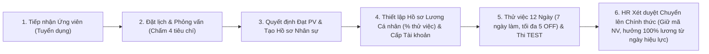
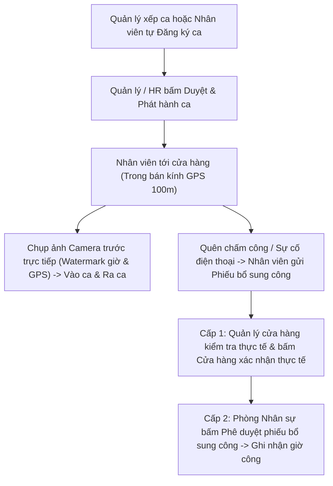
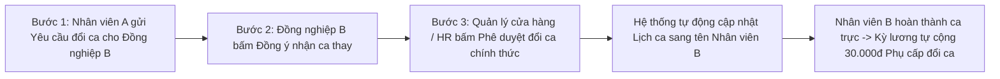
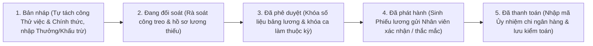
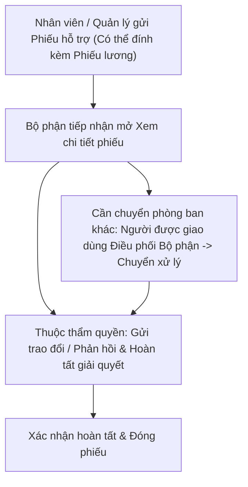

# TÀI LIỆU HƯỚNG DẪN SỬ DỤNG TOÀN HỆ THỐNG ỤM BÒ MILK HR V5.1

| Thuộc tính tài liệu | Thông tin chi tiết |
| :--- | :--- |
| **Tên hệ thống** | **ỤM BÒ MILK — HỆ THỐNG QUẢN TRỊ NHÂN SỰ, CHẤM CÔNG GPS & TÍNH LƯƠNG CHUỖI** |
| **Phiên bản hệ thống** | `v5.1.0` |
| **Mã hiệu tài liệu** | `UMB-DOC-HDSD-V5.1` |
| **Phạm vi áp dụng** | Toàn bộ Văn phòng Điều hành, Phòng Nhân sự, Phòng Kế toán, Bộ phận Truyền thông Nội bộ và tất cả Cửa hàng trực thuộc chuỗi **Ụm Bò Milk** |
| **Đối tượng sử dụng** | Quản trị hệ thống, Nhân sự, Quản lý cửa hàng, Kế toán, Truyền thông nội bộ, Nhân viên chính thức, Nhân viên thử việc |
| **Thiết bị hỗ trợ** | Máy tính để bàn / Laptop (Cổng Quản trị & Cổng Nhân viên) và Điện thoại thông minh iOS / Android (Cổng Nhân viên tối ưu cảm ứng, GPS & Camera trước) |

> [!IMPORTANT]
> Tài liệu này hướng dẫn chi tiết **100% chức năng thực tế** đang vận hành trên hệ thống **Ụm Bò Milk HR v5.1.0**. Mỗi chức năng đều chỉ rõ: **Đường dẫn mở màn hình (Menu nào ▸ Mục nào ▸ Tab nào)**, **Ai được phép thao tác**, **Trình tự từng bước thực hiện**, **Cách nhập từng ô dữ liệu hợp lệ** và **Lưu ý kiểm soát nghiệp vụ**.

---

## MỤC LỤC ĐIỀU HƯỚNG NHANH

- **PHẦN I — TỔNG QUAN HỆ THỐNG, ĐĂNG NHẬP & QUY TẮC THAO TÁC CHUNG**
  - [Chương 1. Kiến trúc 2 Cổng Làm Việc & Ma trận 7 Vai trò Người dùng](#chương-1-kiến-trúc-2-cổng-làm-việc--ma-trận-7-vai-trò-người-dùng)
  - [Chương 2. Đăng nhập, Hồ sơ Cá nhân, Đổi Mật khẩu / Mã PIN & Đăng xuất](#chương-2-đăng-nhập-hồ-sơ-cá-nhân-đổi-mật-khẩu--mã-pin--đăng-xuất)
  - [Chương 3. Thanh Điều hướng Header, Chuông Thông báo & Công cụ Bảng Dữ liệu Dùng chung](#chương-3-thanh-điều-hướng-header-chuông-thông-báo--công-cụ-bảng-dữ-liệu-dùng-chung)
- **PHẦN II — HƯỚNG DẪN CHI TIẾT CỔNG QUẢN TRỊ & ĐIỀU HÀNH (16 PHÂN HỆ)**
  - **Nhóm 1: Bàn làm việc**
    - [Chương 4. Tổng quan & Thống kê (`/dashboard`)](#chương-4-tổng-quan--thống-kê-dashboard)
    - [Chương 5. Điểm danh & Ca của bạn trên Cổng Quản trị (`/admin/my-attendance`)](#chương-5-điểm-danh--ca-của-bạn-trên-cổng-quản-trị-adminmy-attendance)
    - [Chương 6. Trung tâm Thông báo (`/admin/notifications`)](#chương-6-trung-tâm-thông-báo-adminnotifications)
    - [Chương 7. Phiếu hỗ trợ & Thắc mắc (`/admin/tickets`)](#chương-7-phiếu-hỗ-trợ--thắc-mắc-admintickets)
  - **Nhóm 2: Nhân sự & Phân quyền**
    - [Chương 8. Hồ sơ nhân sự & Xét duyệt Chuyển Chính thức (`/admin/employees`)](#chương-8-hồ-sơ-nhân-sự--xét-duyệt-chuyển-chính-thức-adminemployees)
    - [Chương 9. Tuyển dụng & Phỏng vấn (`/admin/employees?section=recruitment`)](#chương-9-tuyển-dụng--phỏng-vấn-adminemployeessectionrecruitment)
    - [Chương 10. Ngân hàng Đề & Thi TEST Nghiệp vụ (`/admin/employees?section=tests`)](#chương-10-ngân-hàng-đề--thi-test-nghiệp-vụ-adminemployeessectiontests)
    - [Chương 11. Tài khoản người dùng & Phân quyền Chi tiết (`/admin/accounts`)](#chương-11-tài-khoản-người-dùng--phân-quyền-chi-tiết-adminaccounts)
    - [Chương 12. Lịch làm việc & Phân ca Đa chế độ (`/admin/schedules`)](#chương-12-lịch-làm-việc--phân-ca-đa-chế-độ-adminschedules)
    - [Chương 13. Điểm danh, Phiếu Bổ sung công, Nghỉ phép OFF & Đổi ca (`/admin/schedules?section=workflows`)](#chương-13-điểm-danh-phiếu-bổ-sung-công-nghỉ-phép-off--đổi-ca-adminschedulessectionworkflows)
    - [Chương 14. Kỳ lương, Đối soát Công, Thưởng/Khấu trừ & Hồ sơ Lương Cá nhân (`/admin/payroll`)](#chương-14-kỳ-lương-đối-soát-công-thưởngkhấu-trừ--hồ-sơ-lương-cá-nhân-adminpayroll)
  - **Nhóm 3: Hệ thống & Cá nhân**
    - [Chương 15. Chi nhánh, Tọa độ GPS, Khung ca mẫu, Định biên & Vị trí công việc (`/admin/branches`)](#chương-15-chi-nhánh-tọa-độ-gps-khung-ca-mẫu-định-biên--vị-trí-công-việc-adminbranches)
    - [Chương 16. Nhật ký kiểm toán Hệ thống (`/admin/audit-logs`)](#chương-16-nhật-ký-kiểm-toán-hệ-thống-adminaudit-logs)
    - [Chương 17. Tích hợp Dữ liệu, Bộ máy Đối soát Toàn vẹn & Hàng đợi Email (`/admin/integrations`)](#chương-17-tích-hợp-dữ-liệu-bộ-máy-đối-soát-toàn-vẹn--hàng-đợi-email-adminintegrations)
    - [Chương 18. Chính sách Vận hành, Chế độ Bảo trì & Sao lưu Khôi phục (`/admin/integrations?section=governance`)](#chương-18-chính-sách-vận-hành-chế-độ-bảo-trì--sao-lưu-khôi-phục-adminintegrationssectiongovernance)
    - [Chương 19. Bản tin Truyền thông Nội bộ & Kho Media (`/admin/integrations?section=comms`)](#chương-19-bản-tin-truyền-thông-nội-bộ--kho-media-adminintegrationssectioncomms)
- **PHẦN III — HƯỚNG DẪN CHI TIẾT CỔNG TỰ PHỤC VỤ NHÂN VIÊN (`/nv`)**
  - [Chương 20. Bố cục Cổng Nhân viên (Di động & Máy tính) & Trang Tổng quan Ca hôm nay (`/nv`)](#chương-20-bố-cục-cổng-nhân-viên-di-động--máy-tính--trang-tổng-quan-ca-hôm-nay-nv)
  - [Chương 21. Điểm danh Vào ca / Ra ca bằng GPS & Camera Trực tiếp (`/nv/diem-danh`)](#chương-21-điểm-danh-vào-ca--ra-ca-bằng-gps--camera-trực-tiếp-nvdiem-danh)
  - [Chương 22. Xem Lịch Làm Việc 3 Chế độ & Tự Đăng ký Ca (`/nv/lich`)](#chương-22-xem-lịch-làm-việc-3-chế-độ--tự-đăng-ký-ca-nvlich)
  - [Chương 23. Xin Nghỉ phép OFF Định kỳ & Báo Nghỉ Khẩn cấp Sát Giờ Ca (`/nv/nghi-phep`)](#chương-23-xin-nghỉ-phép-off-định-kỳ--báo-nghỉ-khẩn-cấp-sát-giờ-ca-nvnghi-phep)
  - [Chương 24. Gửi Yêu cầu Đổi Ca Nội bộ & Nhận Ca Thay Đồng nghiệp (`/nv/doi-ca`)](#chương-24-gửi-yêu-cầu-đổi-ca-nội-bộ--nhận-ca-thay-đồng-nghiệp-nvdoi-ca)
  - [Chương 25. Theo dõi Bảng Công Cá nhân & Gửi Phiếu Bổ sung Công (`/nv/cong`)](#chương-25-theo-dõi-bảng-công-cá-nhân--gửi-phiếu-bổ-sung-công-nvcong)
  - [Chương 26. Xem & Xác nhận Phiếu lương, Gửi Phiếu Hỗ trợ & Hộp thư Thông báo (`/nv/phieu-luong`, `/nv/ho-tro`, `/nv/thong-bao`)](#chương-26-xem--xác-nhận-phiếu-lương-gửi-phiếu-hỗ-trợ--hộp-thư-thông-báo-nvphieu-luong-nvho-tro-nvthong-bao)
  - [Chương 27. Làm Bài Kiểm tra Nghiệp vụ Toàn màn hình & Đọc Bản tin Nội bộ (`/nv/bai-kiem-tra`, `/nv/ban-tin`)](#chương-27-làm-bài-kiểm-tra-nghiệp-vụ-toàn-màn-hình--đọc-bản-tin-nội-bộ-nvbai-kiem-tra-nvban-tin)
- **PHẦN IV — SƠ ĐỒ QUY TRÌNH NGHIỆP VỤ CHUẨN LIÊN BỘ PHẬN**
  - [Chương 28. Sơ đồ 5 Quy trình Phối hợp Cốt lõi Toàn Chuỗi](#chương-28-sơ-đồ-5-quy-trình-phối-hợp-cốt-lõi-toàn-chuỗi)
- **PHẦN V — CẨM NANG XỬ LÝ TÌNH HUỐNG & CÂU HỎI THƯỜNG GẶP**
  - [Chương 29. Bảng Tra cứu Xử lý Sự cố Thực tế tại Cửa hàng & Văn phòng](#chương-29-bảng-tra-cứu-xử-lý-sự-cố-thực-tế-tại-cửa-hàng--văn-phòng)

---

# PHẦN I — TỔNG QUAN HỆ THỐNG, ĐĂNG NHẬP & QUY TẮC THAO TÁC CHUNG

## Chương 1. Kiến trúc 2 Cổng Làm Việc & Ma trận 7 Vai trò Người dùng

Hệ thống **Ụm Bò Milk HR v5.1.0** được phân tách thành **2 cổng giao diện chuyên biệt** nhưng dùng chung một nguồn dữ liệu thời gian thực duy nhất:

1. **Cổng Quản trị & Điều hành (`/dashboard`, `/admin/...`)**: Dành cho Ban Giám đốc, Quản trị hệ thống, Phòng Nhân sự, Phòng Kế toán, Quản lý cửa hàng và Bộ phận Truyền thông nội bộ. Giao diện tối ưu cho màn hình rộng toàn khung (`100% chiều ngang`), hỗ trợ lọc sâu, xử lý hàng loạt và xuất báo cáo Excel chuẩn kế toán.
2. **Cổng Tự phục vụ Nhân viên (`/nv/...`)**: Dành cho toàn bộ nhân sự cửa hàng (Nhân viên thử việc, Nhân viên chính thức) và cả nhân sự khối văn phòng khi cần thao tác nhanh trên điện thoại di động.

### 1.1. Bảng Ma trận 7 Vai trò Chuẩn & Trang Đích Sau Đăng nhập

Khi đăng nhập thành công, hệ thống tự động nhận diện vai trò và chuyển hướng người dùng về đúng màn hình làm việc chính:

| STT | Vai trò trên giao diện | Cổng làm việc chính | Trang đích mặc định sau đăng nhập | Phạm vi nghiệp vụ trọng tâm |
| :---: | :--- | :--- | :--- | :--- |
| 1 | **Quản trị hệ thống** | Cổng Quản trị & Cổng NV | `/dashboard` (`Tổng quan & Thống kê`) | Toàn quyền cấu hình chi nhánh, ca làm, tài khoản, phân quyền, đối soát dữ liệu, chính sách, sao lưu, bảo trì và giám sát toàn bộ phân hệ. |
| 2 | **Nhân sự** | Cổng Quản trị & Cổng NV | `/admin/employees` (`Hồ sơ nhân sự`) | Tuyển dụng, phỏng vấn, tiếp nhận nhân sự mới, xét duyệt lên chính thức, ngân hàng đề thi TEST, duyệt lịch ca, duyệt nghỉ phép, duyệt bù công cấp cuối. |
| 3 | **Quản lý cửa hàng** | Cổng Quản trị & Cổng NV | `/admin/schedules` (`Lịch làm việc & Phân ca`) | Xếp lịch ca chi nhánh, duyệt đăng ký ca, xác nhận thực tế phiếu bổ sung công (cấp 1), duyệt đổi ca nội bộ, điều phối người thay ca nghỉ đột xuất. |
| 4 | **Kế toán** | Cổng Quản trị & Cổng NV | `/admin/payroll` (`Kỳ lương & Thưởng`) | Thiết lập hồ sơ lương cá nhân, khởi tạo kỳ lương, đối soát bảng công, nhập thưởng/phụ cấp/khấu trừ, chốt & phát hành phiếu lương, xác nhận chi trả, báo cáo lương/doanh thu. |
| 5 | **Truyền thông nội bộ** | Cổng Quản trị & Cổng NV | `/admin/integrations?section=comms` (`Bản tin Truyền thông Nội bộ`) | Soạn bản tin nội bộ, hẹn giờ phát tự động, quản lý nhóm người nhận, chiến dịch truyền thông, Kho Media nội bộ và theo dõi tỷ lệ xác nhận đã đọc. |
| 6 | **Nhân viên chính thức** | Cổng Nhân viên | `/nv` (`Tổng quan & Ca hôm nay`) | Điểm danh GPS & Camera, đăng ký ca, xin nghỉ OFF định kỳ (`4 ngày/chu kỳ`), đổi ca nội bộ (nhận phụ cấp `30.000đ/ca` khi nhận ca thay), gửi bù công, xác nhận phiếu lương, thi TEST, đọc bản tin. |
| 7 | **Nhân viên thử việc** | Cổng Nhân viên | `/nv` (`Tổng quan & Ca hôm nay`) | Điểm danh GPS & Camera, theo dõi tiến độ chu kỳ thử việc `12 ngày` (`7 ngày làm việc`, tối đa `5 ngày nghỉ OFF`), hưởng tỷ lệ `% lương thử việc` theo hồ sơ lương cá nhân (mặc định `85%`), làm bài thi TEST đầu vào. |

> [!NOTE]
> Nhân sự thuộc khối Quản trị, Nhân sự, Kế toán, Quản lý cửa hàng hoặc Truyền thông nội bộ có thể chuyển nhanh sang Cổng Nhân viên bất kỳ lúc nào bằng nút **`Cổng NV`** trên góc phải thanh Header, hoặc tự chấm công ngay trong Cổng Quản trị tại mục **`Điểm danh & Ca của bạn`**.

---

## Chương 2. Đăng nhập, Hồ sơ Cá nhân, Đổi Mật khẩu / Mã PIN & Đăng xuất

### 2.1. Hướng dẫn Đăng nhập Cổng Quản trị (`/login`)

- **Đường dẫn truy cập**: Mở trình duyệt và truy cập địa chỉ `/login` (Màn hình hiển thị tiêu đề **`ỤM BÒ MILK — Quản trị`**).
- **Trình tự thao tác**:
  1. **Bước 1**: Nhập thông tin vào ô **`Tên đăng nhập hoặc Số điện thoại`**.
  2. **Bước 2**: Nhập mật khẩu vào ô **`Mật khẩu`**.
  3. **Bước 3**: Nhấn nút **`Đăng nhập hệ thống`** (hoặc nhấn phím `Enter`).

| Tên trường nhập | Bắt buộc | Quy chuẩn nhập liệu & Ví dụ | Quy tắc kiểm tra hợp lệ của hệ thống |
| :--- | :---: | :--- | :--- |
| **Tên đăng nhập hoặc Số điện thoại** | Có | Nhập tên tài khoản quản trị (ví dụ: `admin`, `hr.manager`) hoặc số điện thoại 10 chữ số bắt đầu bằng `0` (ví dụ: `0901000001`). | Không được để trống. Nếu nhập chuỗi 10 chữ số bắt đầu bằng số `0`, hệ thống tự động hiểu là đăng nhập bằng Số điện thoại nhân sự. |
| **Mật khẩu** | Có | Tối thiểu `6 ký tự` (hoặc Mã PIN `6 chữ số` nếu là nhân viên). | Nếu nhập sai quá số lần quy định, tài khoản sẽ tạm khóa bảo vệ và cần Quản trị hệ thống bấm **`Mở khóa đăng nhập`**. |

### 2.2. Hướng dẫn Đăng nhập Cổng Nhân viên (`/nv/login`)

- **Đường dẫn truy cập**: Truy cập `/nv/login` trên trình duyệt điện thoại hoặc bấm liên kết **`Cổng Nhân viên`** ngay dưới chân biểu mẫu đăng nhập quản trị (Màn hình hiển thị tiêu đề **`ỤM BÒ MILK — Nhân viên`**).
- **Trình tự thao tác**:
  1. **Bước 1**: Tại ô **`Số điện thoại`**, nhập đúng số điện thoại cá nhân đã đăng ký với Phòng Nhân sự — **10 chữ số bắt đầu bằng số `0`** (ví dụ: `0901000008`). Tuyệt đối không nhập mã quốc gia `+84`.
  2. **Bước 2**: Tại ô **`Mật khẩu`**, nhập mật khẩu hoặc mã PIN được cấp (tối thiểu `6 ký tự`).
  3. **Bước 3**: Nhấn nút **`Đăng nhập hệ thống`**.

> [!TIP]
> Nếu phiên đăng nhập hết hạn khi đang mở máy qua ngày mới, hệ thống sẽ tự động đăng xuất an toàn và đưa bạn về đúng màn hình đăng nhập tương ứng (`/login` hoặc `/nv/login`).

### 2.3. Cập nhật Hồ sơ Cá nhân, Tài khoản Ngân hàng & Đổi Mật khẩu / Mã PIN

Mọi người dùng (ở cả Cổng Quản trị lẫn Cổng Nhân viên) đều có thể tự cập nhật thông tin liên hệ, số tài khoản ngân hàng nhận lương và đổi mật khẩu bảo mật:

- **Cách mở hộp thoại**:
  - **Trên Cổng Quản trị**: Bấm vào **Khối Tài khoản (Avatar + Họ tên + Vai trò)** ở góc trên cùng bên phải thanh Header ▸ chọn **`Hồ sơ cá nhân & Cập nhật thông tin`** (hoặc chọn **`Đổi mật khẩu / Mã PIN bảo mật`**).
  - **Trên Cổng Nhân viên**: Bấm vào **Khối Tài khoản** ở góc trên bên phải ▸ chọn **`Cập nhật thông tin cá nhân`** hoặc **`Đổi mật khẩu / Mã PIN`**.
- **Hộp thoại mở ra gồm 2 Tab chuyên biệt**:

#### Tab 1: `Thông tin cá nhân & Ngân hàng`

| Tên trường nhập | Bắt buộc | Hướng dẫn nhập liệu cụ thể |
| :--- | :---: | :--- |
| **Họ và tên** | Có | Nhập đầy đủ họ, tên đệm và tên có dấu tiếng Việt chuẩn theo CCCD (ví dụ: `Nguyễn Thị Minh Anh`). |
| **Số điện thoại** | Không sửa hoặc 10 số | Chuẩn 10 chữ số bắt đầu bằng `0` (ví dụ: `0902345678`). Dùng để đăng nhập và nhận liên hệ công việc. |
| **Email** | Tùy chọn (Khuyến nghị có) | Nhập địa chỉ email cá nhân hợp lệ (ví dụ: `minhanh@gmail.com`) để nhận Phiếu lương hàng tháng, kết quả duyệt đơn và thông báo ca làm qua Gmail. |
| **Chỗ ở hiện tại** | Tùy chọn | Ghi rõ số nhà, đường, phường/xã, quận/huyện nơi đang cư trú thực tế để thuận tiện điều phối chi nhánh. |
| **Liên hệ khẩn cấp** | Tùy chọn | Họ tên và mối quan hệ của người thân liên hệ khi khẩn cấp (ví dụ: `Nguyễn Văn Bình — Anh trai`). |
| **SĐT khẩn cấp** | Tùy chọn | Số điện thoại 10 số bắt đầu bằng `0` của người liên hệ khẩn cấp. |
| **Ngân hàng** | Khuyến nghị có | Tên ngân hàng nhận lương (ví dụ: `Vietcombank`, `Techcombank`, `MB Bank`, `ACB`). |
| **Số tài khoản** | Khuyến nghị có | Nhập chính xác dãy số tài khoản ngân hàng (không chứa khoảng trắng thừa). |
| **Chủ tài khoản** | Khuyến nghị có | Nhập tên chủ tài khoản in hoa không dấu khớp thẻ ngân hàng (ví dụ: `NGUYEN THI MINH ANH`). |

Sau khi kiểm tra kỹ, nhấn nút **`Lưu thông tin cá nhân`**.

#### Tab 2: `Đổi mật khẩu / Mã PIN bảo mật`

1. **Bước 1**: Nhập mật khẩu đang dùng vào ô **`Mật khẩu / Mã PIN hiện tại`**.
2. **Bước 2**: Nhập mật khẩu mới vào ô **`Mật khẩu / Mã PIN mới`** (tối thiểu `6 ký tự`).
   - *Mẹo đồng bộ thông minh*: Nếu bạn nhập mật khẩu mới là **đúng 6 chữ số** (ví dụ: `682491`), hệ thống sẽ tự động đồng bộ chuỗi 6 số này làm cả Mật khẩu đăng nhập lẫn Mã PIN bảo mật nhanh.
3. **Bước 3**: Nhập lại chính xác vào ô **`Xác nhận mật khẩu / Mã PIN mới`**.
4. **Bước 4**: Nhấn nút **`Xác nhận đổi mật khẩu`**.

---

## Chương 3. Thanh Điều hướng Header, Chuông Thông báo & Công cụ Bảng Dữ liệu Dùng chung

Toàn bộ các màn hình trên Cổng Quản trị được chuẩn hóa đồng nhất để người dùng chỉ cần làm quen một lần là sử dụng thành thạo tất cả 16 phân hệ.

### 3.1. Các Nút Tiện ích trên Thanh Header Trên Cùng

- **Góc trái**:
  - **Nút Thu gọn / Mở rộng Menu trái**: Giúp mở rộng tối đa không gian bảng biểu khi làm việc với bảng lương hoặc lưới phân ca tuần.
  - **Thanh Đường dẫn (Breadcrumb)**: Hiển thị vị trí hiện tại theo cấu trúc 3 cấp `Quản trị / {Nhóm chức năng} / {Tên màn hình hiện tại}`.
- **Góc phải**:
  - **Nút `Trợ lý đối soát`**: Mở nhanh phân hệ **`Tích hợp, Đối soát & Email`** để kiểm tra sức khỏe dữ liệu và hàng đợi đồng bộ.
  - **Biểu tượng Chuông `Thông báo`** (kèm số lượng thông báo chưa đọc màu đỏ):
    - Bấm vào chuông để mở khung xem nhanh **`Thông báo đã nhận`**.
    - Trong khung xem nhanh có: nút **Loa nghe thử âm báo**, công tắc **`Chuông` / `Tắt`** (bật hoặc tắt âm thanh khi có đơn từ/thông báo mới), nút **`Làm mới`** và nút **`Xem chi tiết tất cả thông báo`**.
  - **Nút `Cổng NV`**: Chuyển sang giao diện Cổng Tự phục vụ Nhân viên (`/nv`).
  - **Khối Tài khoản Đăng nhập**: Hiển thị Avatar chữ cái đầu, Họ tên, Nhãn vai trò tiếng Việt và menu thao tác cá nhân / **`Đăng xuất hệ thống`**.

### 3.2. Thanh Công cụ Lọc, Tìm kiếm, Làm mới & Xuất Excel (`Thanh lọc đầu bảng`)

Ngay phía trên mọi bảng danh sách đều có khung trắng chứa thanh công cụ tiêu chuẩn:

1. **Ô Tìm kiếm Từ khóa (Góc trái)**:
   - Hệ thống tích hợp **cơ chế chờ thông minh `400ms`**: bạn chỉ cần gõ xong từ khóa (tên nhân viên, mã nhân sự, số điện thoại, mã đơn...), hệ thống tự động lọc mượt mà mà không giật trang trên từng phím gõ.
   - Muốn tìm ngay lập tức: nhấn phím **`Enter`**. Muốn xóa bộ lọc từ khóa: nhấn biểu tượng dấu **`x`** bên phải ô nhập.
2. **Các Ô Chọn Lọc (`Select` bên cạnh ô tìm kiếm)**: Cho phép lọc kết hợp theo Chi nhánh, Giai đoạn, Vị trí công việc, Trạng thái, Phòng ban...
3. **Nút `Xuất Excel` (Góc phải)**: Tải xuống ngay tệp bảng tính Excel (`.xls`) được trình bày chuẩn biểu mẫu doanh nghiệp theo đúng dữ liệu đang lọc trên màn hình.
4. **Nút `Làm mới` (Góc phải)**: Bắt buộc hệ thống đồng bộ lại dữ liệu mới nhất trực tiếp từ cơ sở dữ liệu đám mây (Google Sheets) kèm hiệu ứng xoay trạng thái. Hệ thống không tự động xoay tải lại ngầm gây gián đoạn khi bạn đang đọc hoặc nhập liệu.
5. **Nút Hành động Chính màu xanh dương (`+ Thêm ...` / `+ Tạo ...`)**: Mở biểu mẫu tạo mới bản ghi của phân hệ hiện tại.

### 3.3. Bảng Dữ liệu, Thao tác Hàng loạt & Ngăn Trượt Xem Chi tiết

- **Thanh Thao tác Hàng loạt (Xuất hiện khi tích chọn ô vuông đầu dòng)**:
  - Ngay khi bạn tích chọn từ **1 dòng trở lên** ở cột hộp kiểm bên trái bảng, một thanh công cụ màu xanh nhạt sẽ hiện ngay trên đầu bảng:
    - Hiển thị **`Đã chọn N bản ghi`**.
    - Nếu các dòng đang chọn có nhiều trạng thái khác nhau, hệ thống tự động gợi ý các nút lọc nhanh **`Chỉ giữ: {Trạng thái}`** để bạn lọc đúng các bản ghi hợp lệ cần duyệt/kích hoạt.
    - Cung cấp các nút xử lý hàng loạt như: **`Duyệt đã chọn`**, **`Kích hoạt đã chọn`**, **`Chuyển Chính thức đã chọn`**, **`Xóa đã chọn`**, **`Xuất Excel đã chọn`** và **`Bỏ chọn tất cả`**.
- **Cột `Thao tác` cố định bên phải mỗi dòng**:
  - **Nút Biểu tượng Con mắt (`Xem chi tiết`)**: Mở ngăn trượt thông tin chi tiết đầy đủ của dòng đó.
  - **Nút Ba chấm (`...` — `Mở danh sách thao tác`)**: Bấm vào để mở thực đơn các hành động nghiệp vụ áp dụng riêng cho dòng đó (Chỉnh sửa, Phê duyệt, Từ chối, Chuyển chính thức, Khóa, Xóa...).
- **Ngăn Trượt Chi tiết (`Phóng to` / `Thu nhỏ`)**:
  - Mặc định mở rộng `85%` chiều ngang màn hình giúp đọc rõ bảng biểu và lịch sử.
  - Bấm nút **`Phóng to`** ở góc trên phải ngăn trượt để mở rộng lên `95%` màn hình; bấm **`Thu nhỏ`** để trở về `85%`; bấm **`Đóng`** để thoát.

---

# PHẦN II — HƯỚNG DẪN CHI TIẾT CỔNG QUẢN TRỊ & ĐIỀU HÀNH (16 PHÂN HỆ)

---

## Chương 4. Tổng quan & Thống kê (`/dashboard`)

- **Đường dẫn mở màn hình**: `Menu trái ▸ Bàn làm việc ▸ Tổng quan & Thống kê`
- **Đối tượng sử dụng**: Quản trị hệ thống, Nhân sự, Quản lý cửa hàng, Kế toán.
- **Mục đích nghiệp vụ**: Nắm bắt toàn cảnh sức khỏe nhân sự, tỷ lệ điểm danh theo thời gian thực, quỹ lương tạm tính và xử lý ngay các đầu việc tồn đọng trong ngày chỉ từ một màn hình điều hành.

### 4.1. Hướng dẫn Sử dụng Bộ lọc Tổng quan Đa chiều

Tại thanh **`Bộ lọc Tổng quan:`** đầu trang, bạn có thể kết hợp 4 tiêu chí để xem số liệu bóc tách riêng:
1. **Chi nhánh**: Chọn **`Tất cả chi nhánh`** hoặc chọn riêng từng cửa hàng (ví dụ: `CN01 — Ụm Bò Milk Quận 1`).
2. **Vị trí công việc**: Lọc riêng nhóm Pha chế, Thu ngân, Phục vụ, Cửa hàng trưởng...
3. **Giai đoạn / Trạng thái**: Chọn xem riêng **`Nhân viên thử việc`**, **`Nhân viên chính thức`** hoặc nhân sự đang hoạt động.
4. **Khung thời gian**: Chuyển nhanh giữa **`Hôm nay`**, **`Tuần này`**, **`Tháng này`** và **`Toàn bộ kỳ`**.
5. Nhấn **`Đặt lại bộ lọc`** để đưa toàn bộ chỉ số về mặc định toàn hệ thống, hoặc nhấn **`Làm mới số liệu`** ở góc trên phải để nạp số liệu vừa phát sinh.

### 4.2. Cách Đọc & Xử lý 4 Khối Điều hành Trọng tâm trên Bàn làm việc

1. **Khối `Danh sách Hành động ưu tiên cần xử lý ngay`**:
   - Hệ thống tự động tổng hợp các việc đang chờ duyệt và gắn nút điều hướng trực tiếp:
     - **`Xử lý thiếu ca`** ▸ Chuyển thẳng tới lưới lịch các ca đang thiếu định biên hoặc có báo nghỉ đột xuất.
     - **`Duyệt đơn từ`** ▸ Mở danh sách Đơn nghỉ phép OFF và Yêu cầu đổi ca đang chờ phê duyệt.
     - **`Mở đối soát công`** ▸ Mở danh sách Phiếu bổ sung công đang chờ Cửa hàng xác nhận hoặc Nhân sự duyệt.
     - **`Xét chuyển chính thức`** ▸ Mở danh sách nhân sự thử việc đã hoàn thành đủ ngày công chu kỳ 12 ngày để xét duyệt lên chính thức.
     - **`Mở Tuyển dụng & PV`** ▸ Mở lịch phỏng vấn ứng viên sắp diễn ra.
     - **`Duyệt lịch phân ca`** ▸ Mở các ca nhân viên mới đăng ký đang ở trạng thái chờ duyệt.
2. **Khối `Tổng quan Quỹ lương, Giờ công & Đối soát Kế toán`**:
   - Theo dõi tổng giờ công tích lũy, tổng giờ tăng ca (OT), quỹ lương tạm tính trong kỳ và trạng thái kỳ lương hiện tại.
3. **Bảng `Tình trạng Nhân sự, Điểm danh & Ca đang diễn ra theo Chi nhánh`**:
   - Hiển thị từng chi nhánh đang có bao nhiêu ca trong ngày, bao nhiêu người đã vào ca đúng giờ, đi trễ hoặc chưa chấm công. Bảng hỗ trợ kéo ngang mượt mà trên màn hình nhỏ và nút thao tác gọn `...` ở cuối dòng để nhảy thẳng vào lịch hoặc điểm danh của chi nhánh đó.
4. **Bảng `Báo cáo Nhân sự & Vận hành Chi nhánh`**:
   - Cho phép lọc chi tiết theo Vị trí, Khung ca và bấm nút **`Xuất Báo cáo Excel`** để tải báo cáo tổng hợp trình Ban Giám đốc.

---

## Chương 5. Điểm danh & Ca của bạn trên Cổng Quản trị (`/admin/my-attendance`)

- **Đường dẫn mở màn hình**: `Menu trái ▸ Bàn làm việc ▸ Điểm danh & Ca của bạn`
- **Đối tượng sử dụng**: Toàn bộ nhân sự có quyền truy cập Cổng Quản trị (Quản lý cửa hàng, Nhân sự, Kế toán, Truyền thông nội bộ, Quản trị hệ thống) muốn tự chấm công và quản lý đơn từ cá nhân của chính mình mà không cần thoát ra Cổng Nhân viên.

### 5.1. Thao tác Chấm công & Tự Đăng ký Ca

1. **Chấm công ca hôm nay**:
   - Chọn ca làm việc đã được phê duyệt của bạn trong ngày hôm nay trên thẻ đầu trang.
   - Nhấn nút **`Vào ca của bạn (Chụp ảnh Camera & GPS)`** khi bắt đầu ca (hoặc **`Ra ca của bạn (Chụp ảnh Camera & GPS)`** khi kết thúc ca) ▸ Cho phép trình duyệt truy cập Vị trí GPS và Camera ▸ Chụp ảnh xác thực để ghi nhận giờ công.
   - Nếu ca ngày hôm trước bị quên chấm công (hiển thị vắng mặt), nhấn nút **`Làm phiếu bổ sung công bù ca vắng mặt này`** ngay trên thẻ ca để gửi giải trình.
2. **Đăng ký ca mới**: Nhấn nút **`Đăng ký ca làm của bạn`** ▸ Chọn Ngày làm việc, Khung ca và Ghi chú ▸ Gửi chờ duyệt.
3. **Quản lý hồ sơ công cá nhân qua 4 Tab bên dưới**:
   - **Tab 1 — `Lịch sử Điểm danh của bạn`**: Xem lại toàn bộ thời gian vào/ra ca, ảnh selfie chấm công và khoảng cách GPS.
   - **Tab 2 — `Phiếu bổ sung công của bạn`**: Theo dõi tiến độ duyệt các phiếu bù công bạn đã gửi hoặc tạo phiếu mới.
   - **Tab 3 — `Lịch cá nhân, Nghỉ OFF & Đổi ca`**: Chuyển đổi xem lịch cá nhân theo Tuần/Tháng/Bảng, tạo Đơn xin nghỉ phép OFF hoặc gửi Yêu cầu đổi ca với đồng nghiệp.
   - **Tab 4 — `Phiếu lương của bạn`**: Xem và xác nhận phiếu lương cá nhân hàng tháng.

---

## Chương 6. Trung tâm Thông báo (`/admin/notifications`)

- **Đường dẫn mở màn hình**: `Menu trái ▸ Bàn làm việc ▸ Trung tâm Thông báo`
- **Đối tượng sử dụng**: Mọi vai trò trên Cổng Quản trị (riêng quyền **`Phát thông báo mới`** dành cho Quản trị hệ thống, Nhân sự và Quản lý được phân quyền).

### 6.1. Quản lý & Lọc Hộp thư Thông báo

- Trên thanh điều khiển đầu trang:
  - Bật/tắt công tắc **`Chuông thông báo`** để nhận âm báo tức thời khi có đơn từ mới gửi đến, bấm **`Nghe thử chuông`** để kiểm tra loa thiết bị.
  - Bấm **`Đánh dấu tất cả đã đọc`** để dọn sạch số đếm thông báo chưa xem.
- Sử dụng 5 bộ lọc kết hợp: **Phân loại thông báo**, **Phạm vi nhận**, **Mức độ ưu tiên**, **Trạng thái đọc (`Tất cả` / `Chưa đọc` / `Đã đọc`)** và **Thứ tự sắp xếp**.

### 6.2. Hướng dẫn Phát hành Thông báo Mới

1. **Bước 1**: Nhấn nút **`Phát thông báo mới`** màu xanh ở góc trên bên phải.
2. **Bước 2**: Điền thông tin trong hộp thoại **`Phát hành Thông báo Hệ thống / Theo Vai trò / Cá nhân`**:

| Tên trường nhập | Bắt buộc | Hướng dẫn chọn & nhập liệu cụ thể |
| :--- | :---: | :--- |
| **Phân loại thông báo** | Có | Chọn nhóm nội dung phù hợp (Thông báo vận hành, Nhắc lịch ca, Nhân sự, Lương thưởng, Hệ thống...). |
| **Mức độ ưu tiên** | Có | Chọn mức độ (`Bình thường`, `Quan trọng`, `Khẩn cấp` — mức Khẩn cấp sẽ nổi bật đầu hộp thư người nhận). |
| **Phạm vi người nhận** | Có | Chọn 1 trong 3 phạm vi: **1. Toàn hệ thống** (gửi cho tất cả tài khoản); **2. Theo nhóm vai trò** (chọn tiếp vai trò nhận như Quản lý cửa hàng, Nhân viên thử việc...); **3. Theo cá nhân** (tìm và chọn đích danh nhân sự nhận). |
| **Tiêu đề thông báo** | Có | Viết ngắn gọn, rõ trọng tâm (ví dụ: `Nhắc hoàn tất đăng ký lịch làm việc Tuần 45 trước 17:00 Thứ Sáu`). |
| **Nội dung chi tiết** | Có | Ghi đầy đủ hướng dẫn, thời hạn thực hiện và đầu mối liên hệ khi cần. |

3. **Bước 3**: Nhấn nút **`Phát thông báo ngay`**. Thông báo sẽ đổ chuông thời gian thực trên màn hình của người nhận ngay lập tức.

---

## Chương 7. Phiếu hỗ trợ & Thắc mắc (`/admin/tickets`)

- **Đường dẫn mở màn hình**: `Menu trái ▸ Bàn làm việc ▸ Phiếu hỗ trợ & Thắc mắc`
- **Đối tượng sử dụng**: Toàn bộ các bộ phận (Nhân sự, Kế toán, Quản lý cửa hàng, Quản trị hệ thống) để tiếp nhận và giải quyết thắc mắc chính thức từ nhân viên hoặc phối hợp liên phòng ban.

### 7.1. Cách Lọc Đúng Việc Cần Xử lý

Tại bộ lọc **`Phạm vi phiếu`** trên thanh công cụ:
- Chọn **`Giao cho tôi / Bộ phận`**: Xem các phiếu gửi tới phòng ban của bạn để tiếp nhận xử lý ngay.
- Chọn **`Chỉ định đích danh tôi`**: Xem các phiếu đã phân công trực tiếp tên bạn phụ trách.
- Chọn **`Phiếu do tôi tạo`**: Theo dõi phản hồi của các phiếu do chính bạn gửi sang bộ phận khác.

### 7.2. Tạo Phiếu Hỗ trợ Mới

Nhấn nút **`Tạo phiếu hỗ trợ`** và điền các trường sau:

| Tên trường nhập | Bắt buộc | Hướng dẫn chọn & nhập liệu cụ thể |
| :--- | :---: | :--- |
| **Phân loại vấn đề cần hỗ trợ** | Có | Chọn đúng chủ đề: Thắc mắc lương / phụ cấp, Sai lệch giờ công, Đổi lịch / Nghỉ phép, Tài khoản / Kỹ thuật, Đề xuất vận hành... |
| **Mức độ ưu tiên** | Có | Chọn `Thấp`, `Trung bình`, `Cao` hoặc `Khẩn cấp`. |
| **Bộ phận tiếp nhận** | Có | Chọn đúng phòng ban có thẩm quyền giải quyết (`Kế toán`, `Nhân sự`, `Quản lý cửa hàng`, `Quản trị hệ thống`). |
| **Người phụ trách xử lý** | Tùy chọn | Có thể để trống để cả bộ phận tiếp nhận cùng thấy, hoặc chọn đích danh người xử lý. |
| **Phiếu lương đính kèm** | Khi hỏi lương | Nếu chọn phân loại thắc mắc về lương, hãy chọn kỳ Phiếu lương cần đối chiếu để Kế toán mở xem ngay từ phiếu hỗ trợ. |
| **Tiêu đề phiếu hỗ trợ** | Có | Tóm tắt rõ vấn đề (ví dụ: `Đề nghị kiểm tra phụ cấp nhận đổi ca ngày 18/10 tại CN02`). |
| **Nội dung thắc mắc / yêu cầu chi tiết** | Có | Mô tả cụ thể ngày ca, số giờ hoặc khoản tiền cần kiểm tra để bộ phận xử lý đối chiếu nhanh nhất. |

### 7.3. Quy trình Phản hồi, Điều phối Chuyển tiếp & Đóng Phiếu

Bấm biểu tượng **Con mắt (`Xem chi tiết`)** trên dòng phiếu để mở ngăn trượt xử lý:
1. **Trao đổi thêm thông tin**: Nhập nội dung vào khung phản hồi và nhấn **`Gửi trao đổi`**.
2. **Giải quyết dứt điểm**: Nhập kết quả xử lý và nhấn **`Phản hồi & Hoàn tất giải quyết`** để chuyển trạng thái phiếu sang đã giải quyết.
3. **Điều phối chuyển tiếp sang bộ phận khác (`Điều phối Bộ phận / Người xử lý`)**:
   - Chọn bộ phận mới hoặc người phụ trách mới ▸ Nhấn **`Chuyển xử lý`**.
4. **Kết thúc hồ sơ**: Khi người gửi đã hài lòng với kết quả, nhấn **`Đóng phiếu`**.

> [!WARNING]
> **Quy tắc kiểm soát phân quyền nghiêm ngặt trên Phiếu hỗ trợ**:
> - **Chỉ những phiếu được giao cho bạn (hoặc giao cho bộ phận của bạn xử lý)** thì bạn mới được phép sử dụng khối **`Điều phối Bộ phận / Người xử lý`** để chuyển tiếp sang bộ phận khác.
> - **Đối với phiếu do chính bạn tạo ra**: Bạn chỉ được sửa tiêu đề/nội dung khi phiếu còn ở trạng thái **`Chờ tiếp nhận`** và **không được tự ý điều chỉnh bộ phận xử lý chuyển tiếp** của phiếu mình đã gửi.

---

## Chương 8. Hồ sơ nhân sự & Xét duyệt Chuyển Chính thức (`/admin/employees`)

- **Đường dẫn mở màn hình**: `Menu trái ▸ Nhân sự & Phân quyền ▸ Hồ sơ nhân sự`
- **Đối tượng sử dụng**: Nhân sự, Quản trị hệ thống (Quản lý cửa hàng và Kế toán có quyền tra cứu theo phạm vi phân quyền).

### 8.1. Tiếp nhận Hồ sơ Nhân sự Mới (4 Tab Toàn diện)

1. **Bước 1**: Nhấn nút **`Thêm nhân sự mới`** màu xanh ở góc trên phải thanh công cụ.
2. **Bước 2**: Điền lần lượt 4 Tab trong hộp thoại **`Tiếp nhận Hồ sơ Nhân sự mới`** (cửa sổ rộng dễ nhập liệu):

#### Tab 1: `Thông tin & Phân công`

| Tên trường nhập | Bắt buộc | Hướng dẫn nhập liệu & Quy tắc kiểm tra |
| :--- | :---: | :--- |
| **Họ và tên** | Có | Nhập họ tên đầy đủ chuẩn giấy tờ tùy thân (ví dụ: `Trần Quốc Bảo`). |
| **Mã nhân sự** | Tự động / Có | Hệ thống tự sinh mã kế tiếp (ví dụ: `NV0025`). Có thể bấm nút **`Tự sinh`** để lấy mã mới không trùng. |
| **Số điện thoại** | Có | **Bắt buộc 10 chữ số bắt đầu bằng số `0`** (ví dụ: `0908123456`). Không được trùng với nhân sự khác đang tồn tại. |
| **Chi nhánh** | Có | Chọn cửa hàng/văn phòng làm việc chính của nhân sự. |
| **Vị trí công việc** | Khuyến nghị có | Chọn vị trí trong danh sách (Pha chế, Thu ngân, Ca trưởng...). Nếu thiếu vị trí mới, bấm nút **`Cấu hình`** ngay cạnh ô chọn để thêm vị trí mới tức thời. |
| **Giai đoạn** | Có | Chọn **`Nhân viên thử việc`** (mặc định cho người mới vào) hoặc **`Nhân viên chính thức`**. |
| **Trạng thái** | Có | Mặc định là đang làm việc hoạt động. |
| **Ca mặc định** | Tùy chọn | Chọn khung ca ưu tiên thường xuyên của nhân sự (Ca sáng, Ca chiều, Ca tối...). |
| **Hình thức** | Có | Chọn **`Thử việc (Chu kỳ 12 ngày)`**, **`Bán thời gian (Theo ca)`** hoặc **`Toàn thời gian`**. |
| **Ngày bắt đầu** | Có | Chọn ngày thực tế nhân sự bắt đầu nhận việc (dùng làm mốc tính chu kỳ thử việc 12 ngày). |

#### Tab 2: `Cá nhân, Email & CCCD`

- Nhập **`Email`** (để nhận thông báo kích hoạt tài khoản & phiếu lương), **`Ngày sinh`**, **`Giới tính`**, **`Số CCCD`** (đúng 12 chữ số), **`Ngày cấp CCCD`**, **`Mã số thuế`**, **`Địa chỉ thường trú`**, **`Chỗ ở hiện tại`**, **`Liên hệ khẩn cấp`**, **`SĐT khẩn cấp`** và **`Ghi chú`**.
- *(Lưu ý: Khi chỉnh sửa hồ sơ nhân sự đã nghỉ, Tab này sẽ có thêm trường **`Ngày nghỉ việc`** và **`Lý do nghỉ việc`** để lưu trữ lịch sử nhân sự).*

#### Tab 3: `Hồ sơ Lương & Ngân hàng` (Hồ sơ Lương Cá nhân)

> [!IMPORTANT]
> Trong hệ thống **Ụm Bò Milk HR v5.1.0**, lương được cấu hình **riêng biệt theo từng cá nhân nhân sự** (tuyệt đối không gộp cứng theo vai trò). Thiết lập ngay tại Tab 3 khi tiếp nhận giúp hệ thống tự động tính lương chính xác ngay từ ca làm việc đầu tiên.

| Tên trường nhập | Bắt buộc | Hướng dẫn thiết lập cụ thể |
| :--- | :---: | :--- |
| **Hình thức lương** | Có | Chọn 1 trong 3 hình thức: **`Theo giờ`** (nhân viên làm theo giờ ca), **`Theo tháng (lương cứng)`** (nhân sự văn phòng / cửa hàng trưởng hưởng lương tháng chia công chuẩn), hoặc **`Theo ca`**. |
| **Lương chính thức** | Có | Nhập đơn giá 100% khi đã lên chính thức (ví dụ: `28.000` đ/giờ nếu chọn Theo giờ, hoặc `9.500.000` đ/tháng nếu chọn Theo tháng). |
| **% thử việc** | Có | Tỷ lệ hưởng lương trong giai đoạn thử việc (mặc định hệ thống điền **`85`** tương ứng `85%` mức lương chính thức; có thể điều chỉnh riêng cho từng cá nhân, ví dụ `90%` hoặc `100%`). |
| **Công chuẩn / tháng** | Với lương tháng | Số ngày công chuẩn trong tháng để quy đổi đơn giá ngày công (ví dụ: `26` công). |
| **Giờ chuẩn / ngày (ca)** | Có | Số giờ tiêu chuẩn của 1 ngày công / ca chuẩn (ví dụ: `8` giờ hoặc `5` giờ). |
| **Hệ số tăng ca (OT)** | Có | Hệ số nhân đơn giá cho giờ làm thêm tăng ca (mặc định `1.5`, tức `150%`). |
| **Các khoản Phụ cấp cố định** | Tùy chọn | Nhập mức cố định theo kỳ (nếu có): **`Phụ cấp ăn ca`**, **`Thưởng chuyên cần`**, **`Phụ cấp đi lại`**, **`Phụ cấp trách nhiệm`**, **`Phụ cấp khác`**. |
| **Ngân hàng / Số TK / Chủ TK** | Tùy chọn | Điền thông tin tài khoản ngân hàng nhận lương của nhân viên. |

#### Tab 4: `Tài khoản Liên kết`

Chọn 1 trong 3 phương thức cấp quyền đăng nhập cho nhân sự mới:
1. **`Tự động tạo tài khoản mới` (Khuyên dùng)**: Hệ thống tự sinh **`Tên đăng nhập`** (có nút **`Tự sinh`**) và **`Mật khẩu`** khởi tạo (có nút **`Tự sinh MK`**). Nhân viên có thể đăng nhập ngay bằng **Số điện thoại + Mật khẩu** vừa tạo.
2. **`Liên kết tài khoản có sẵn`**: Chọn một tài khoản chưa gắn hồ sơ nhân sự trong danh sách.
3. **`Chưa liên kết tài khoản`**: Chỉ lưu hồ sơ nhân sự, cấp tài khoản sau tại phân hệ Tài khoản người dùng.

3. **Bước 3**: Nhấn nút xác nhận lưu để hoàn tất tiếp nhận nhân sự.

### 8.2. Quy trình Xét duyệt Nhân viên Thử việc lên Chính thức

Khi nhân sự thử việc hoàn thành chu kỳ đánh giá (mặc định `12 ngày`: `7 ngày làm việc`, tối đa `5 ngày nghỉ OFF`), Phòng Nhân sự thực hiện chuyển giai đoạn như sau:

1. **Bước 1**: Tại bảng **`Hồ sơ nhân sự`**, lọc **`Giai đoạn: Nhân viên thử việc`**.
2. **Bước 2**: Bấm nút **`...`** ở cột `Thao tác` trên dòng nhân viên đạt yêu cầu ▸ chọn **`Chuyển lên Chính thức`** *(hoặc tích chọn nhiều nhân viên và bấm nút **`Chuyển Chính thức đã chọn`** trên thanh thao tác hàng loạt)*.
3. **Bước 3**: Trong hộp thoại xét duyệt:
   - Chọn **`Ngày hiệu lực Chính thức`** (bắt buộc): Kể từ đúng ngày này trở đi, mọi giờ công của nhân viên sẽ tự động được hệ thống tính theo **100% đơn giá Lương chính thức**; các ngày công trước ngày hiệu lực này vẫn được giữ nguyên mức `% thử việc` trong cùng kỳ lương (tự động tách công thử việc và công chính thức chính xác từng ngày).
   - Nhập **`Đánh giá của HR & Điều kiện phê duyệt`** (bắt buộc): Ghi nhận kết quả tay nghề, điểm bài thi TEST và nhận xét của Cửa hàng trưởng.
4. **Bước 4**: Xác nhận phê duyệt. Hệ thống **giữ nguyên Mã nhân sự**, tự động nâng vai trò tài khoản lên **`Nhân viên chính thức`** và gửi thông báo chúc mừng tới nhân viên.

---

## Chương 9. Tuyển dụng & Phỏng vấn (`/admin/employees?section=recruitment`)

- **Đường dẫn mở màn hình**: `Menu trái ▸ Nhân sự & Phân quyền ▸ Tuyển dụng & Phỏng vấn`
- **Đối tượng sử dụng**: Nhân sự, Quản trị hệ thống, Quản lý cửa hàng tham gia phỏng vấn.

### 9.1. Tab 1: `Hồ sơ Ứng viên tuyển dụng`

1. **Tiếp nhận ứng viên**: Nhấn nút **`Thêm ứng viên mới`** ▸ Nhập Họ tên, Số điện thoại (10 số bắt đầu bằng `0`), Email, Vị trí ứng tuyển, Chi nhánh nguyện vọng, Nguồn ứng tuyển (Facebook, Giới thiệu nội bộ, Website...) và Liên kết CV / Ghi chú kinh nghiệm ▸ Lưu hồ sơ.
2. **Sàng lọc & Liên hệ**:
   - Bấm biểu tượng **Con mắt (`Xem chi tiết`)** để mở hồ sơ ứng viên, sử dụng các nút liên hệ nhanh (Gọi điện, Zalo, Gửi Email) và đánh dấu **`Đã liên hệ`**.
   - Với ứng viên phù hợp, bấm **`Đặt lịch phỏng vấn`** ngay từ dòng ứng viên hoặc trong ngăn chi tiết.

### 9.2. Tab 2: `Lịch Phỏng vấn & Google Meet`

1. **Thiết lập buổi phỏng vấn**:
   - Nhấn **`Đặt lịch phỏng vấn`**.
   - Chọn **Ứng viên**, **Người phỏng vấn phụ trách**, **Ngày phỏng vấn** và **Giờ bắt đầu** *(Lưu ý: Hệ thống chặn đặt lịch phỏng vấn mới vào thời điểm đã qua trong quá khứ)*, **Thời lượng** (mặc định `30 phút`), Hình thức phỏng vấn (Trực tiếp tại chi nhánh hoặc Trực tuyến kèm liên kết **Google Meet**).
2. **Chấm điểm & Ra quyết định Tuyển dụng**:
   - Sau buổi phỏng vấn, mở dòng lịch phỏng vấn ▸ chọn **`Chấm điểm & Ra quyết định HR`**.
   - Nhập điểm đánh giá (thang điểm `0 – 100`) cho 4 tiêu chí:
     - **`Điểm tác phong`**
     - **`Điểm thái độ`**
     - **`Điểm kỹ năng`**
     - **`Điểm tổng kết`**
   - Chọn **`Quyết định của HR`**:
     - **`Đạt phỏng vấn — Mời thử việc`** (sẵn sàng chuyển sang tiếp nhận Hồ sơ nhân sự thử việc)
     - **`Cân nhắc thêm`**
     - **`Không đạt`**
   - Nhập **`Nhận xét chi tiết của HR`** (bắt buộc) và lưu kết quả. Hệ thống hỗ trợ gửi thông báo/email kết quả phỏng vấn chuyên nghiệp cho ứng viên.

---

## Chương 10. Ngân hàng Đề & Thi TEST Nghiệp vụ (`/admin/employees?section=tests`)

- **Đường dẫn mở màn hình**: `Menu trái ▸ Nhân sự & Phân quyền ▸ Ngân hàng Đề & Thi TEST`
- **Đối tượng sử dụng**: Nhân sự, Quản trị hệ thống, Quản lý đào tạo.
- **Mục đích nghiệp vụ**: Chuẩn hóa kiến thức công thức pha chế, quy trình vệ sinh an toàn thực phẩm, nội quy phục vụ và kiểm tra định kỳ hoặc sát hạch cuối kỳ thử việc 12 ngày.

### 10.1. Tab 1: `Ngân hàng Bộ đề kiểm tra` — Tạo Đề Trắc nghiệm

1. Nhấn nút **`Tạo bộ đề mới`**.
2. Tại **Tab `Cấu hình Kỳ thi & Thông số Đề`**:
   - **Mã bộ đề**: Nhấn **`Tự sinh`** hoặc tự đặt mã dễ nhớ.
   - **Tên bộ đề kiểm tra** (bắt buộc): Ví dụ `Sát hạch Công thức Pha chế Chuẩn Ụm Bò Milk Cấp độ 1`.
   - **Nhóm vị trí áp dụng**: Chọn vị trí mục tiêu (Pha chế, Thu ngân, Toàn bộ nhân viên mới...).
   - **Thời gian làm bài (phút)**: Ví dụ `15` phút hoặc `30` phút (hết giờ phòng thi sẽ tự động thu bài).
   - **Điểm chuẩn đạt yêu cầu (`%`)**: Ví dụ `80%` (nhân viên đạt từ `80%` số câu đúng trở lên sẽ được xếp loại Đạt).
   - **Số lần thi tối đa mặc định**: Ví dụ `2` lần.
3. Chuyển sang **Tab `Danh sách Câu hỏi Trắc nghiệm`**:
   - Nhấn nút thêm câu hỏi mới ▸ Nhập nội dung câu hỏi ▸ Nhập nội dung 4 phương án trả lời **A, B, C, D** ▸ Tích chọn phương án **`Đúng`** ▸ Lặp lại cho đến khi đủ bộ câu hỏi ▸ Lưu bộ đề.

### 10.2. Tab 2: `Đợt giao bài & Kết quả thi` — Giao Đề cho Nhân viên

1. Nhấn nút **`Giao bài kiểm tra`**.
2. Chọn **Bộ đề kiểm tra** cần giao.
3. Chọn **Danh sách nhân sự nhận đề** (có thể tìm và chọn cùng lúc nhiều nhân viên thử việc hoặc toàn bộ nhân sự một chi nhánh).
4. Thiết lập **Số lần làm bài tối đa** và **Ngày / Giờ hạn nộp bài** ▸ Xác nhận giao bài. Nhân viên sẽ nhận được thông báo ngay trên Cổng Nhân viên (`/nv/bai-kiem-tra`).
5. *Mở lại lượt thi cho nhân viên*: Nếu nhân viên làm hết số lượt cho phép và được phê duyệt thi lại, bấm sửa đợt giao bài của nhân viên đó ▸ bật công tắc **`Đặt lại số lượt đã thi về 0`** ▸ Lưu cập nhật.

### 10.3. Tab 3: `Lịch sử bài làm`

- Tra cứu điểm số, thời gian bắt đầu/nộp bài của từng lượt thi.
- Bấm xem chi tiết (**`Chi tiết Bài làm Lần #...`**) để kiểm tra từng câu nhân viên đã chọn phương án nào, đúng hay sai so với đáp án chuẩn, và xuất bảng điểm ra Excel bằng nút **`Xuất Excel`**.

---

## Chương 11. Tài khoản người dùng & Phân quyền Chi tiết (`/admin/accounts`)

- **Đường dẫn mở màn hình**: `Menu trái ▸ Nhân sự & Phân quyền ▸ Tài khoản người dùng`
- **Đối tượng sử dụng**: Quản trị hệ thống (và Nhân sự khi được cấp quyền quản lý tài khoản).

### 11.1. Tạo Tài khoản Mới (3 Tab Cấu hình)

Nhấn nút **`Thêm tài khoản mới`** và thiết lập qua 3 Tab:
1. **Tab 1 — `Thông tin Đăng nhập & Vai trò`**:
   - Nhập **`Tên đăng nhập`** (bắt buộc, viết liền không dấu, có nút **`Tự sinh`**), **`Số điện thoại`** (10 số bắt đầu bằng `0`), **`Email`**, **`Mật khẩu khởi tạo`** (tối thiểu 6 ký tự, có nút **`Tự sinh`**), chọn **`Vai trò chính`** (1 trong 7 vai trò chuẩn) và **`Trạng thái ban đầu`**.
2. **Tab 2 — `Phân quyền & Permission bổ sung`**:
   - Hệ thống tự động tích sẵn bộ quyền tiêu chuẩn của vai trò vừa chọn. Nếu một cá nhân kiêm nhiệm thêm đầu việc (ví dụ: Nhân sự kiêm phát Bản tin truyền thông nội bộ), bạn có thể tích bổ sung thêm quyền lẻ tại đây.
3. **Tab 3 — `Liên kết Hồ sơ Nhân sự & Chi nhánh`**:
   - Chọn hồ sơ nhân sự tương ứng và chi nhánh quản lý để đồng bộ dữ liệu chấm công, lịch ca và phiếu lương.

### 11.2. Quản lý Vòng đời Bảo mật Tài khoản (Đơn lẻ & Hàng loạt)

Từ nút **`...`** cuối dòng hoặc tích chọn nhiều dòng trên **`Thanh thao tác hàng loạt`**:
- **`Kích hoạt tài khoản`**: Mở quyền đăng nhập cho tài khoản đang chờ kích hoạt (đồng thời xếp lịch gửi email thông báo kích hoạt nếu có email).
- **`Khóa tạm thời tài khoản`**: Tạm ngưng quyền truy cập khi nhân sự nghỉ dài ngày hoặc đang chờ bàn giao.
- **`Mở khóa đăng nhập`**: Gỡ khóa ngay cho tài khoản bị khóa do nhập sai mật khẩu nhiều lần.
- **`Thu hồi quyền truy cập`**: Dùng khi nhân sự chính thức nghỉ việc — hệ thống yêu cầu nhập **Lý do thu hồi**, vô hiệu hóa toàn bộ phiên đăng nhập đang mở ngay lập tức nhưng vẫn bảo toàn lịch sử công và lương cũ để phục vụ kiểm toán.

---

## Chương 12. Lịch làm việc & Phân ca Đa chế độ (`/admin/schedules`)

- **Đường dẫn mở màn hình**: `Menu trái ▸ Nhân sự & Phân quyền ▸ Lịch làm việc & Phân ca`
- **Đối tượng sử dụng**: Quản lý cửa hàng, Nhân sự, Quản trị hệ thống.

### 12.1. Chuyển đổi 4 Chế độ Điều hành Lịch trên Thanh Công cụ

Sử dụng thanh chọn chế độ xem đầu trang để làm việc linh hoạt theo nhu cầu:
1. **`Lưới Lịch Tuần` (Mặc định — Trực quan nhất khi xếp ca)**:
   - Hiển thị ma trận **Khung ca × 7 Ngày trong tuần (Thứ Hai đến Chủ Nhật)**.
   - Mỗi ô hiển thị danh sách thẻ nhân sự trực ca đó kèm màu trạng thái điểm danh thực tế.
   - **Thao tác xếp ca siêu tốc**: Bấm trực tiếp vào dấu **`+`** ở bất kỳ ô giao giữa Ca và Ngày nào, hộp thoại phân ca sẽ mở ra và tự động điền sẵn đúng Ngày & Khung ca đó!
2. **`Lịch Tháng`**: Xem mật độ phủ ca toàn tháng trên lịch tờ, phát hiện nhanh các ngày cuối tuần hoặc ngày lễ còn mỏng nhân sự.
3. **`Bảng Phân Ca`**: Xem danh sách dạng bảng chi tiết có hộp kiểm đầu dòng để duyệt hàng loạt, xóa hàng loạt hoặc bấm **`Xuất Excel`**.
4. **`Danh Sách Điểm Danh`**: Đối chiếu trực tiếp lịch phân ca với phiên chấm công thực tế ngay tại cùng phân hệ.

### 12.2. Hướng dẫn Xếp Ca Mới & Phê duyệt Ca Nhân viên Tự Đăng ký

- **Xếp ca mới**: Nhấn nút **`Phân ca mới`** (hoặc bấm vào ô trên Lưới Lịch Tuần) ▸ Mở hộp thoại **`Phân Công Ca Làm Việc Mới`**:

| Tên trường nhập | Bắt buộc | Hướng dẫn chọn & nhập liệu cụ thể |
| :--- | :---: | :--- |
| **Nhân sự phân công** | Có | Gõ tên hoặc mã nhân sự để tìm chọn nhanh. |
| **Ngày làm việc** | Có | Chọn ngày trực ca. |
| **Khung ca làm việc (theo chi nhánh)** | Có | Hệ thống tự động lọc đúng các khung ca mẫu áp dụng cho chi nhánh của nhân sự được chọn và tự điền số giờ chuẩn tương ứng. |
| **Loại ngày công** | Có | Chọn **`Ca làm việc chuẩn`**, **`Ca tăng ca (OT)`** hoặc **`Ngày nghỉ phép (OFF)`**. |
| **Số giờ công** | Có | Tự động điền theo khung ca mẫu (có thể điều chỉnh bước `0.5 giờ` cho ca linh hoạt). |
| **Trạng thái lịch** | Có | Chọn **`Đã phân ca chính thức`** (nhân viên được chấm công ngay) hoặc để chờ duyệt. |
| **Ghi chú phân ca / Đánh dấu đặc biệt** | Tùy chọn | Ví dụ: `Trực mở quầy sáng`, `Hướng dẫn nhân viên thử việc mới`. |

- **Phê duyệt ca nhân viên tự đăng ký**:
  - Khi nhân viên gửi đăng ký ca từ Cổng Nhân viên, đầu trang lịch sẽ xuất hiện thanh thông báo màu vàng hiển thị số lượng ca đang chờ duyệt.
  - Quản lý cửa hàng / Nhân sự có thể bấm nút **`Duyệt & Phát hành`** ngay trên thanh cảnh báo (hoặc tích chọn nhiều dòng ở chế độ `Bảng Phân Ca` ▸ chọn duyệt hàng loạt, hoặc bấm vào từng ca nháp ▸ nhấn **`Duyệt & Phát hành ca`**).

> [!IMPORTANT]
> Nhân viên **chỉ có thể bấm Điểm danh Vào ca / Ra ca** đối với những ca đã được Quản lý cửa hàng hoặc Nhân sự chuyển sang trạng thái **`Đã phân ca chính thức`**. Các ca thuộc kỳ lương đã chốt phê duyệt sẽ tự động khóa chỉnh sửa/xóa để bảo vệ tính toàn vẹn của bảng lương.

---

## Chương 13. Điểm danh, Phiếu Bổ sung công, Nghỉ phép OFF & Đổi ca (`/admin/schedules?section=workflows`)

- **Đường dẫn mở màn hình**: `Menu trái ▸ Nhân sự & Phân quyền ▸ Điểm danh, Nghỉ phép & Đổi ca`
- **Đối tượng sử dụng**: Quản lý cửa hàng, Nhân sự, Quản trị hệ thống.

Màn hình này tập trung **5 Tab điều hành tác nghiệp hàng ngày** của chuỗi cửa hàng:

### 13.1. Tab 1: `Lịch sử Điểm danh Vào/Ra ca`

- Giám sát toàn bộ các lượt chấm công Vào ca và Ra ca của nhân viên theo thời gian thực.
- Bấm biểu tượng **Con mắt (`Xem chi tiết`)** trên dòng chấm công để kiểm tra:
  - **Ảnh chụp khuôn mặt trực tiếp** có đóng dấu thời gian và tọa độ.
  - **Khoảng cách GPS thực tế (mét)** từ vị trí đứng của nhân viên tới tâm tọa độ chi nhánh.
  - Cảnh báo đi trễ, về sớm hoặc sai số định vị để kịp thời nhắc nhở.

### 13.2. Tab 2: `Phiếu bổ sung công` (Quy trình Kiểm soát Chéo 2 Cấp)

Áp dụng khi nhân viên có đi làm thực tế nhưng quên bấm vào/ra ca, điện thoại sập nguồn hoặc lỗi GPS/Camera:
1. **Cấp 1 — Quản lý cửa hàng xác nhận thực tế tại quầy**:
   - Quản lý cửa hàng kiểm tra camera cửa hàng / sổ giao ca thực tế ▸ Bấm vào dòng phiếu ▸ chọn **`Cửa hàng xác nhận thực tế`**.
2. **Cấp 2 — Phòng Nhân sự phê duyệt ghi nhận công chính thức**:
   - Sau khi Cửa hàng đã xác nhận, Nhân sự kiểm tra hợp lệ ▸ Bấm **`Phê duyệt phiếu bổ sung công`** (giờ công được cộng chính thức vào bảng công tính lương) hoặc **`Từ chối phiếu bổ sung công`** (kèm lý do từ chối rõ ràng).
3. *Tạo hộ trực tiếp*: Quản lý hoặc Nhân sự cũng có thể chủ động nhấn nút **`Tạo phiếu bổ sung công`** (hoặc bấm trực tiếp từ chi tiết một ca bị đánh dấu Vắng mặt trên Lịch làm việc) để lập phiếu bù công cho nhân sự.

### 13.3. Tab 3: `Đơn xin nghỉ phép (OFF)`

- Khi nhân viên gửi đơn xin nghỉ phép OFF, hệ thống tự động tính toán và hiển thị ngay trên cột **`Định mức & Định biên`**:
  - Nhân viên đó đã dùng bao nhiêu ngày OFF trong chu kỳ (đối chiếu với hạn mức `5 ngày` của chu kỳ thử việc 12 ngày hoặc `4 ngày/chu kỳ` của nhân viên chính thức).
  - Nếu duyệt đơn nghỉ này thì ca hôm đó tại cửa hàng còn lại bao nhiêu người trực, có vi phạm **Định biên nhân sự tối thiểu** của ca hay không.
- Quản lý / Nhân sự bấm **`Phê duyệt đơn nghỉ phép`** hoặc **`Từ chối đơn nghỉ phép`** (hỗ trợ duyệt hàng loạt khi tích chọn nhiều đơn).

### 13.4. Tab 4: `Đơn xin đổi ca` (Quy trình 3 Bước & Tự động Cộng Phụ cấp `30.000đ`)

- Chỉ những yêu cầu đổi ca mà **đồng nghiệp nhận ca thay đã bấm đồng ý** mới chuyển lên bước chờ Quản lý / Nhân sự phê duyệt chính thức.
- Khi Quản lý cửa hàng hoặc Nhân sự bấm **`Phê duyệt đổi ca chính thức`**:
  1. Hệ thống tự động hoán đổi/chuyển người trực trên Lịch phân ca chính thức.
  2. Hệ thống tự động ghi nhận khoản **Phụ cấp nhận đổi ca (`30.000đ/ca`)** cho nhân sự nhận ca thay khi hoàn thành ca trực đó trong kỳ lương.

### 13.5. Tab 5: `Báo nghỉ đột xuất` (Xử lý Ca Khẩn cấp `<12h`)

- Dành cho các trường hợp nhân viên gặp sự cố sức khỏe/gia đình khẩn cấp sát giờ vào ca (dưới `12 giờ` trước giờ bắt đầu ca).
- Quản lý cửa hàng xử lý ngay tại Tab này bằng 1 trong 2 thao tác:
  - Chọn nhân sự thay thế và bấm **`Xác nhận đã có người thay ca`** / **`Xác nhận đã điều phối người thay ca`** để cập nhật lịch trực ngay lập tức.
  - Nếu cửa hàng không đủ người xoay ca nội bộ, bấm **`Báo thiếu ca khẩn cấp lên HR`** để Phòng Nhân sự điều động nhân sự chi nhánh lân cận sang hỗ trợ.

---

## Chương 14. Kỳ lương, Đối soát Công, Thưởng/Khấu trừ & Hồ sơ Lương Cá nhân (`/admin/payroll`)

- **Đường dẫn mở màn hình**: `Menu trái ▸ Nhân sự & Phân quyền ▸ Kỳ lương & Thưởng`
- **Đối tượng sử dụng**: Kế toán, Quản trị hệ thống (Nhân sự phối hợp đối soát bảng công).

Màn hình Kế toán Tiền lương gồm **5 phân mục lớn** trên thanh chọn đầu trang:

### 14.1. Phân mục 1: `Bảng lương & Phiếu lương` — Quy trình Chốt Lương 5 Bước Chuẩn

#### A. Khởi tạo Kỳ lương mới
1. Nhấn nút **`Tạo kỳ lương mới`**.
2. Trong hộp thoại **`Khởi tạo Kỳ Lương Mới`**, nhập **`Tên kỳ lương`** (ví dụ: `Kỳ lương Tháng 10/2026`), chọn **`Từ ngày`**, **`Đến ngày`** và **`Ghi chú`** ▸ Nhấn **`Khởi tạo kỳ lương`**.
3. Ngay khi khởi tạo, hệ thống tự động quét toàn bộ ngày công từng người, tự động tách riêng **công trong giai đoạn thử việc** (nhân `% thử việc`) và **công từ ngày lên chính thức** (nhân `100%` mức chính thức), cộng giờ tăng ca (OT), phụ cấp đổi ca (`30.000đ/ca`), phụ cấp cố định và các khoản thưởng/khấu trừ để lập Bảng lương nháp tức thời.

#### B. Thanh Tiến trình Chốt Kỳ Lương 5 Bước Một Chiều

Trên đầu bảng lương hiển thị thanh 5 bước trạng thái rõ ràng:

| Bước | Trạng thái Kỳ lương | Nút Thao tác Chuyển bước | Ý nghĩa & Quy tắc Kiểm soát Kế toán |
| :---: | :--- | :--- | :--- |
| **1** | **Bản nháp** | **`Chuyển sang Đối soát công`** | Cho phép bấm **`Tính lại`**, thêm/sửa thưởng & khấu trừ, hoặc **`Xóa kỳ`** nếu tạo nhầm. |
| **2** | **Đang đối soát** | **`Phê duyệt & Chốt bảng lương`** | Kế toán và Nhân sự rà soát lần cuối. Nếu còn nhân sự có giờ công nhưng chưa thiết lập Hồ sơ lương cá nhân, hệ thống sẽ hiện cảnh báo vàng và chặn phê duyệt cho tới khi bổ sung đủ hồ sơ lương. Có thể bấm **`Trả về Bản nháp`** nếu cần. |
| **3** | **Đã phê duyệt** | **`Phát hành Phiếu lương`** | Số liệu bảng lương và các ca làm việc thuộc kỳ được **khóa bảo vệ**, không bị biến động ngầm. Vẫn có thể **`Trả về Đang đối soát`** trước khi phát hành. |
| **4** | **Đã phát hành** | **`Xác nhận Đã thanh toán`** | Hệ thống chính thức sinh **Phiếu lương cá nhân** gửi tới từng nhân viên trên Cổng Nhân viên và qua Email (có nút **`Gửi lại phiếu lương`** khi cần đồng bộ lại thông báo). Từ bước này, bảng lương **bất biến — không thể mở khóa sửa đè**. |
| **5** | **Đã thanh toán** | *(Hoàn tất chu kỳ)* | Khi bấm **`Xác nhận Đã thanh toán`**, Kế toán nhập **Mã chứng từ / Ủy nhiệm chi** (ví dụ: `UNC-202610-01`) để lưu vết thanh toán ngân hàng hoàn chỉnh. |

#### C. Xem Phiếu lương Chi tiết, Xuất Excel & Tạo Bản Điều chỉnh Sau Phát hành
- Bấm **`Xuất Bảng lương Excel`** để tải bảng tổng hợp thanh toán lương toàn công ty.
- Bấm vào bất kỳ dòng nhân sự nào trên bảng lương để mở ngăn trượt **`Phiếu lương chi tiết`**:
  - Xem đầy đủ 4 Tab phân rã từng ngày công, đơn giá áp dụng, phụ cấp, thưởng/khấu trừ và bấm **`Xuất phiếu lương Excel`**.
  - **Xử lý sai lệch sau khi kỳ lương đã phát hành**: Tuyệt đối không sửa đè phiếu lương cũ; Kế toán bấm nút **`Tạo bản điều chỉnh`** ngay trong ngăn Phiếu lương để ghi nhận khoản chênh lệch cộng/trừ minh bạch kèm lý do kiểm toán.

### 14.2. Phân mục 2: `Bảng chấm công & Đối soát`
- Tổng hợp số ca, tổng giờ công chuẩn, giờ tăng ca, số ca quên chấm công hoặc còn phiếu bù công treo chưa duyệt của từng nhân sự trong kỳ để xử lý dứt điểm trước khi bấm Phê duyệt bảng lương.

### 14.3. Phân mục 3: `Thưởng, Phụ cấp & Khấu trừ`
- Khi kỳ lương đang ở **`Bản nháp`** hoặc **`Đang đối soát`**, nhấn nút **`Thêm Thưởng / Phụ cấp`** để mở hộp thoại **`Thêm Khoản Thưởng / Phụ cấp / Điều chỉnh Lương`**:
  - Chọn **`Nhân sự`**, **`Loại khoản mục`** (Thưởng KPI / Doanh số, Thưởng nóng, Phụ cấp phát sinh, Điều chỉnh cộng lương, Tạm ứng lương, Khấu trừ vi phạm/đền bù...), nhập **`Nội dung trên phiếu lương`**, **`Số lượng`**, **`Đơn giá / Số tiền`** (VNĐ) và **`Ghi chú`** ▸ Nhấn **`Thêm khoản mục`**. Bảng lương tự động tính lại số thực lĩnh ngay lập tức.

### 14.4. Phân mục 4: `Hồ sơ lương nhân sự` (Điều chỉnh Lương & Lịch sử Lương)
- Quản lý toàn bộ mức lương cá nhân của từng nhân sự.
- **Cách tăng lương / điều chỉnh chế độ lương đúng chuẩn**:
  - Mở dòng nhân sự ▸ Thực hiện điều chỉnh mức lương mới với **`Ngày hiệu lực`** cụ thể (ví dụ tăng lương từ ngày `15/10/2026`).
  - Hệ thống tự động đóng ngày kết thúc của mức lương cũ vào `14/10/2026` và áp dụng mức mới từ `15/10/2026` (nửa đầu tháng tính lương cũ, nửa cuối tháng tính lương mới chính xác từng ngày) đồng thời lưu trọn vẹn trong **`Lịch sử lương`**. Các mức lương đã dùng chốt kỳ lương trước đó được khóa không cho xóa.

### 14.5. Phân mục 5: `Báo cáo Lương / Doanh thu`
- **Tab 1 — `Đối chiếu Chi phí Lương / Doanh thu`**: Nhấn nút **`Nhập Doanh thu đối chiếu`** ▸ Chọn Kỳ lương, Chi nhánh và nhập Doanh thu thực tế của cửa hàng để hệ thống tự động tính tỷ lệ **`% Chi phí Lương / Doanh thu`**, giúp Ban Giám đốc đánh giá hiệu quả định biên từng điểm bán.
- **Tab 2 — `Tổng hợp Quỹ lương theo Kỳ lương`**: So sánh biến động quỹ lương, tổng thu nhập và tổng thực lĩnh qua các tháng.

---

## Chương 15. Chi nhánh, Tọa độ GPS, Khung ca mẫu, Định biên & Vị trí công việc (`/admin/branches`)

- **Đường dẫn mở màn hình**: `Menu trái ▸ Hệ thống & Cá nhân ▸ Chi nhánh & Ca làm`
- **Đối tượng sử dụng**: Quản trị hệ thống (Nhân sự được phép quản lý thêm Danh mục Vị trí công việc).

Màn hình gồm **3 phân mục cấu hình nền tảng**:

### 15.1. Phân mục 1: `Danh sách Chi nhánh & Tọa độ GPS`

Nhấn nút **`Thêm chi nhánh mới`** (hoặc bấm sửa chi nhánh hiện có) để thiết lập qua 2 Tab:
1. **Tab 1 — `Thông tin Chi nhánh & Giờ mở cửa`**:
   - **`Mã chi nhánh`** (bắt buộc, ví dụ `CN05` — bấm nút **`Tự sinh`** để lấy mã tự động), **`Tên chi nhánh`** (bắt buộc), **`Địa chỉ cửa hàng`**, **`SĐT liên hệ cửa hàng`** (10 số bắt đầu bằng `0`), **`Giờ mở cửa`** (ví dụ `07:00`), **`Giờ đóng cửa`** (ví dụ `22:30`), **`Ngày hiệu lực`**, **`Trạng thái`** và **`Ghi chú vận hành chi nhánh`**.
2. **Tab 2 — `Tọa độ GPS & Bán kính Điểm danh`**:
   - **Cách lấy tọa độ chính xác 100% tại quầy**: Khi đang đứng trực tiếp tại cửa hàng bằng điện thoại hoặc laptop có Wi-Fi/GPS, bấm nút **`Lấy vị trí hiện tại`** — hệ thống sẽ tự động đo và điền **`Vĩ độ GPS (Lat)`** cùng **`Kinh độ GPS (Lng)`**. Bấm **`Xem trên Google Maps`** để kiểm tra ghim vị trí trên bản đồ.
   - **`Bán kính GPS (m)`**: Khoảng cách tối đa cho phép nhân viên đứng chấm công tính từ tâm cửa hàng (mặc định **`100`** mét, cho phép cấu hình từ `10m` đến `2000m`).
   - **`Sai số tối đa (m)`**: Ngưỡng độ nhiễu tín hiệu GPS thiết bị chấp nhận được (mặc định **`50`** mét).

### 15.2. Phân mục 2: `Danh mục Khung ca mẫu` & `Định biên Nhân sự Theo Ca`

- **Tab `Mẫu Ca Làm Việc Chuẩn`**:
  - Nhấn **`Thêm mẫu ca`** ▸ Chọn **`Chi nhánh áp dụng`** (`Tất cả chi nhánh (Dùng chung)` hoặc chọn riêng 1 chi nhánh có giờ mở cửa đặc thù), nhập **`Tên ca hiển thị`** (ví dụ: `Ca sáng`), **`Mã định danh ca`** (bấm **`Tự sinh`**), **`Giờ bắt đầu`**, **`Giờ kết thúc`**, **`Giờ công chuẩn`**, **`Nghỉ giữa ca (phút)`** và **`Ngày hiệu lực`** ▸ Lưu mẫu ca.
- **Tab `Định Biên Nhân Sự Theo Ca`**:
  - Nhấn **`Thêm định biên ca`** ▸ Chọn **`Chi nhánh áp dụng`**, **`Khung ca áp dụng`**, nhập **`Số NS tối thiểu / ca`** (ví dụ `2` người), **`Số NS tối đa / ca`** (ví dụ `6` người) và chọn **`Chế độ kiểm soát định biên`**:
    - **`Chặn cứng khi thiếu định biên`**: Hệ thống từ chối cho duyệt thêm đơn xin nghỉ OFF nếu việc nghỉ làm số người trực còn lại tụt xuống dưới mức tối thiểu.
    - **`Cảnh báo mềm khi thiếu người`**: Vẫn cho phép Quản lý duyệt linh hoạt nhưng hiển thị cảnh báo thiếu người rõ ràng.

### 15.3. Phân mục 3: `Danh mục Vị trí Công việc`
- Quản lý danh sách các vị trí công việc chuẩn toàn chuỗi (thêm mới, chỉnh sửa tên/mô tả, ngưng áp dụng hoặc xuất Excel) để đồng bộ cho Hồ sơ nhân sự, Tuyển dụng và Báo cáo vận hành.

---

## Chương 16. Nhật ký kiểm toán Hệ thống (`/admin/audit-logs`)

- **Đường dẫn mở màn hình**: `Menu trái ▸ Hệ thống & Cá nhân ▸ Nhật ký kiểm toán`
- **Đối tượng sử dụng**: Quản trị hệ thống.
- **Đặc tính bảo mật**: Mọi thao tác thêm, sửa, xóa, duyệt đơn, đổi mật khẩu, chốt lương đều được tự động ghi vết. Nhật ký kiểm toán là **dữ liệu bất biến** — không ai có thể chỉnh sửa hoặc xóa vĩnh viễn một dòng nhật ký.
- **Hướng dẫn tra cứu & quản lý dung lượng**:
  1. Dùng ô tìm kiếm từ khóa, lọc theo **Phân hệ nghiệp vụ** và **Vai trò người thao tác** để truy vết ai đã thay đổi dữ liệu vào ngày giờ nào.
  2. Bấm biểu tượng **Con mắt (`Xem chi tiết`)** để đối chiếu trực tiếp bảng giá trị **Trước khi sửa** và **Sau khi sửa**.
  3. Chuyển đổi giữa **`Nhật ký Hiện hành`** và **`Kho Lưu trữ Đã dọn`**: Quản trị viên có thể chọn **`Lưu trữ & Làm trống`** để chuyển các nhật ký cũ sang kho lưu trữ giúp bảng hiện hành gọn nhẹ, và có thể bấm **`Khôi phục tất cả`** bất kỳ lúc nào cần thanh tra lại.

---

## Chương 17. Tích hợp Dữ liệu, Bộ máy Đối soát Toàn vẹn & Hàng đợi Email (`/admin/integrations`)

- **Đường dẫn mở màn hình**: `Menu trái ▸ Hệ thống & Cá nhân ▸ Tích hợp, Đối soát & Email` (hoặc bấm nút **`Trợ lý đối soát`** trên thanh Header).
- **Đối tượng sử dụng**: Quản trị hệ thống.

Màn hình gồm **3 Tab giám sát kỹ thuật cao cấp**:

1. **Tab 1 — `Đồng bộ Dữ liệu & Hàng đợi`**:
   - Kiểm tra 6 chỉ số sức khỏe hệ thống (`Kết nối dữ liệu`, `Bộ nhớ dữ liệu`, `Hàng đợi xử lý`, `Cần đối soát`, `Thời gian thực`, `Sao lưu gần nhất`).
   - Xem số lượng bản ghi của toàn bộ các bảng dữ liệu đã nạp và trạng thái hàng đợi ghi tuần tự. Nhấn **`Kiểm tra & Làm mới`** ở góc trên phải để đồng bộ lại toàn bộ bộ nhớ đệm.
2. **Tab 2 — `Đối soát Toàn vẹn Dữ liệu`**:
   - Nhấn nút **`Quét & Tự động sửa lỗi`**.
   - Bộ máy đối soát sẽ rà quét toàn bộ các bảng dữ liệu để phát hiện liên kết mồ côi, trùng mã/số điện thoại hoặc giao dịch đa bảng bị gián đoạn và tự động đồng bộ sửa chữa an toàn, trả về báo cáo số bản ghi đã quét và số mục đã tự sửa.
3. **Tab 3 — `Mẫu Email & Gửi thử Gmail`**:
   - Chọn mẫu thông báo Email doanh nghiệp trong danh sách thả xuống để xem trước giao diện thư thực tế ngay trong khung xem trước.
   - Nhập **`Tên người nhận`** và **`Email người nhận`** ▸ nhấn **`Gửi Email mẫu này`** để kiểm tra kết nối gửi thư Gmail thực tế.
   - Giám sát **Hàng đợi chống nghẽn Email** (tự động chia lô gửi an toàn để tránh giới hạn chống thư rác của Google) và nhấn **`Quét & Gửi lô hàng đợi ngay`** khi muốn đẩy thư đi tức thời.

---

## Chương 18. Chính sách Vận hành, Chế độ Bảo trì & Sao lưu Khôi phục (`/admin/integrations?section=governance`)

- **Đường dẫn mở màn hình**: `Menu trái ▸ Hệ thống & Cá nhân ▸ Chính sách & Sao lưu Bảo trì`
- **Đối tượng sử dụng**: Quản trị hệ thống (Nhân sự có thể phối hợp quản lý và phổ biến Chính sách vận hành).

### 18.1. Tab 1: `Chính sách Vận hành & Quy định`
- Nhấn nút **`Ban hành chính sách / quy định mới`** để thiết lập văn bản quy định nội bộ, tham số quy chế nhân sự, nội quy chấm công hoặc quy định thưởng phạt theo ngày hiệu lực.
- Để gửi thông báo bắt buộc nắm quy định mới tới toàn bộ nhân sự trên hệ thống, bấm nút **`...`** trên dòng chính sách ▸ chọn **`Phổ biến toàn công ty (Gửi thông báo)`** *(hoặc tích chọn nhiều chính sách và bấm **`Phổ biến chính sách đã chọn`**)*. Các chính sách cốt lõi của hệ thống được gắn nhãn **`Khóa cốt lõi`** để chống xóa nhầm.

### 18.2. Tab 2: `Bảo trì & Sao lưu`
1. **Điều khiển `Chế độ Bảo trì`**:
   - Bước 1: Chọn **Phạm vi bảo trì** (`Phạm vi: Toàn hệ thống`, `Phạm vi: Cổng Nhân viên`, `Phạm vi: Điểm danh GPS`, `Phạm vi: Kỳ lương` hoặc `Phạm vi: Cổng Quản trị`).
   - Bước 2: Chọn **`Giờ mở lại`** dự kiến (bắt buộc phải chọn giờ mở lại trước khi bật, ví dụ `23:30`).
   - Bước 3: Gạt công tắc sang **Bật** (`ĐANG BẢO TRÌ`). Người dùng thuộc phạm vi bảo trì sẽ thấy thông báo lịch sự kèm đúng giờ mở lại dự kiến, trong khi Quản trị hệ thống vẫn truy cập kiểm tra bình thường. Khi hoàn tất nâng cấp, gạt công tắc về **Tắt** (`HOẠT ĐỘNG BÌNH THƯỜNG`).
2. **Sao lưu & Diễn tập Khôi phục Dữ liệu**:
   - Nhấn nút **`Sao lưu ngay`** trước các đợt chốt lương lớn hoặc nâng cấp hệ thống để tạo bản chụp toàn bộ dữ liệu tức thời.
   - Nhấn nút **`Diễn tập Khôi phục`** để hệ thống tự động kiểm tra tính toàn vẹn khả năng đọc phục hồi của bản sao lưu gần nhất (đánh dấu **`Đã kiểm chứng`**).

---

## Chương 19. Bản tin Truyền thông Nội bộ & Kho Media (`/admin/integrations?section=comms`)

- **Đường dẫn mở màn hình**: `Menu trái ▸ Hệ thống & Cá nhân ▸ Bản tin Truyền thông Nội bộ`
- **Đối tượng sử dụng**: Truyền thông nội bộ, Nhân sự, Quản trị hệ thống.

Trung tâm Truyền thông Nội bộ cung cấp trọn bộ **6 Tab chuyên nghiệp**:

### 19.1. Tab 1: `Tổng quan & Cảnh báo phát tin`
- Theo dõi tổng số bản tin đã phát, bản tin đang hẹn giờ chờ phát, tỷ lệ nhân sự đã nhận / đã bấm xác nhận đọc và các cảnh báo gửi lỗi cần xử lý.

### 19.2. Tab 2: `Bản tin, Lịch phát & Đã phát` — Soạn Bản tin & Đặt Lịch Phát Tự động

Nhấn nút **`Tạo & Phát thông báo`** (hoặc **`Đặt lịch phát`**) để mở cửa sổ soạn thảo rộng rãi:

| Tên trường nhập | Bắt buộc | Hướng dẫn thiết lập cụ thể |
| :--- | :---: | :--- |
| **Tiêu đề bản tin** | Có | Nhập tiêu đề thu hút, rõ ràng (ví dụ: `Ra mắt Menu Đồ uống Mùa Lễ Hội & Quy chuẩn Pha chế Mới`). |
| **Mức độ ưu tiên** | Có | Chọn mức độ thông thường, quan trọng hoặc khẩn cấp toàn chuỗi. |
| **Chế độ phát hành** | Có | Chọn 1 trong 3 chế độ: **1. Phát hành ngay lập tức**; **2. Lưu bản nháp** (chỉnh sửa tiếp sau); **3. Đặt lịch hẹn giờ phát tự động** (chọn Ngày phát và Giờ phát — đúng đến phút hẹn, tiến trình nền của hệ thống sẽ tự động phát bản tin và gửi thông báo tới toàn bộ nhóm người nhận ngay cả khi bạn đã tắt máy tính). |
| **Nhóm người nhận** | Có | Chọn gửi Toàn công ty hoặc chọn một `Nhóm người nhận` mục tiêu đã tạo ở Tab 3. |
| **Chiến dịch truyền thông** | Tùy chọn | Gắn bản tin vào chiến dịch tương ứng (ví dụ: `Đào tạo Menu Mới Quý 4`). |
| **Đính kèm tài liệu từ Kho Media** | Tùy chọn | Chọn một hoặc nhiều hình ảnh poster, tài liệu PDF, gói tệp nén `.zip` hoặc biểu mẫu Excel/Word từ Kho Media để nhân viên xem và tải trực tiếp trong bản tin. |
| **Tóm tắt ngắn & Nút hành động (CTA)** | Tùy chọn | Viết đoạn mô tả tóm tắt hiển thị ngoài thẻ tin và đường dẫn nút bấm chuyển hướng nhanh (nếu có). |
| **Yêu cầu xác nhận Đã đọc** | Tùy chọn | Bật tùy chọn này cho các thông báo quy định bắt buộc để thống kê chính xác ai đã bấm nút **`Đã đọc`**, ai chưa đọc. |
| **Nội dung chi tiết bản tin** | Có | Soạn thảo văn bản chi tiết, trình bày rõ ràng các mục nội dung truyền thông. |

### 19.3. Tab 3: `Nhóm người nhận` & Tab 4: `Chiến dịch Truyền thông`
- **Tab 3 (`Nhóm người nhận`)**: Tạo sẵn các tệp đối tượng nhận tin thông minh theo tổ hợp **Chi nhánh + Giai đoạn nhân sự + Vị trí công việc** (ví dụ: Nhóm `Toàn bộ Pha chế các chi nhánh Quận 1 & Quận 3`, hoặc Nhóm `Nhân viên thử việc mới toàn chuỗi`).
- **Tab 4 (`Chiến dịch Truyền thông`)**: Gom nhóm các bản tin theo từng đợt sự kiện nội bộ, thi đua doanh số hoặc đào tạo định kỳ để đánh giá hiệu quả tập trung.

### 19.4. Tab 5: `Kho Media Nội bộ` — Tải Lên Mọi Định dạng Tệp & Tự động Nhận diện Liên kết

1. Nhấn nút **`Tải Tệp / Tài liệu lên Kho Media`**.
2. Bạn có **2 cách đưa tài liệu vào Kho Media** cực kỳ linh hoạt:
   - **Cách 1 — Kéo-thả hoặc Chọn tệp trực tiếp từ máy tính (Tối đa `15 MB` / tệp)**:
     - Hỗ trợ đầy đủ mọi định dạng doanh nghiệp: **Hình ảnh** (`.png`, `.jpg`, `.webp`...), **Tài liệu PDF** (`.pdf`), **Tệp nén đóng gói** (`.zip`, `.rar`, `.7z`), **Bộ văn phòng** (Word `.doc/.docx`, Excel `.xls/.xlsx`, PowerPoint `.ppt/.pptx`), **Video / Âm thanh** (`.mp4`, `.mp3`...).
     - Khi bạn chọn sang một tệp mới, hệ thống tự động cập nhật ngay tên tệp mới, định dạng MIME, phân loại tài liệu và dung lượng chính xác của tệp vừa chọn.
   - **Cách 2 — Dán Liên kết Chia sẻ Google Drive / Liên kết Ngoài (Không giới hạn dung lượng `15 MB`)**:
     - Dùng cho video đào tạo dung lượng lớn hoặc bộ tài liệu nặng đã tải lên Google Drive.
     - Ngay khi dán đường dẫn vào ô liên kết, hệ thống tự động kết nối kiểm tra siêu dữ liệu để **tự điền tên tệp, loại tệp và tự tính dung lượng** mà bạn không cần nhập thủ công, đồng thời phân phối qua luồng tải nội bộ ổn định để mọi nhân viên xem/tải được trên bất kỳ thiết bị nào mà không bị lỗi chặn quyền tài khoản Google cá nhân.

### 19.5. Tab 6: `Theo dõi gửi & Xác nhận đọc`
- Tra cứu danh sách chi tiết từng nhân sự trong đợt phát tin: ai đã nhận thông báo, thời điểm mở xem, ai đã bấm **`Đã đọc`** và bấm nút **`Thử gửi lại thông báo`** cho các trường hợp cần nhắc lại.

---

# PHẦN III — HƯỚNG DẪN CHI TIẾT CỔNG TỰ PHỤC VỤ NHÂN VIÊN (`/nv`)

Cổng Tự phục vụ Nhân viên (`/nv`) được thiết kế ưu tiên cho điện thoại thông minh (Mobile-First) đồng thời tương thích đầy đủ trên máy tính để bàn.

---

## Chương 20. Bố cục Cổng Nhân viên (Di động & Máy tính) & Trang Tổng quan Ca hôm nay (`/nv`)

### 20.1. Cách Điều hướng trên Điện thoại Di động & Máy tính

- **Trên Điện thoại Di động**:
  - **Thanh Header trên cùng**: Hiển thị thương hiệu **Ụm Bò Milk**, biểu tượng **Chuông Thông báo** và **Khối Tài khoản cá nhân** (để cập nhật số tài khoản ngân hàng, đổi mật khẩu / mã PIN 6 số hoặc đăng xuất).
  - **Thanh Điều hướng Đáy Màn hình (5 Nút truy cập một chạm)**:
    1. **`Tổng quan`** (`/nv`)
    2. **`Điểm danh`** (`/nv/diem-danh`)
    3. **`Lịch ca`** (`/nv/lich`)
    4. **`Phiếu lương`** (`/nv/phieu-luong`)
    5. **`Thêm`** (Mở ngăn kéo truy cập đầy đủ các mục còn lại: *Đơn nghỉ OFF & Khẩn cấp, Yêu cầu Đổi ca nội bộ, Bảng công & Bổ sung công, Trung tâm Thông báo, Phiếu hỗ trợ & Thắc mắc, Bài kiểm tra Nghiệp vụ, Bản tin truyền thông nội bộ*).
- **Trên Máy tính / Máy tính bảng**: Toàn bộ 11 mục chức năng hiển thị trực tiếp ở **Menu dọc bên trái** (chia thành 2 nhóm rõ ràng: *Công việc & Chấm công* và *Lương, Đào tạo & Nội bộ*).

### 20.2. Trang `Tổng quan & Ca hôm nay` (`/nv`)

Ngay sau khi đăng nhập `/nv/login`, nhân viên nắm bắt ngay 4 thông tin thiết yếu trong ngày:
1. **Thẻ Hồ sơ & Hạn mức Ngày nghỉ OFF**: Hiển thị Mã nhân sự, Chi nhánh trực thuộc, Giai đoạn hiện tại (`Nhân viên thử việc` hoặc `Nhân viên chính thức`) và số ngày nghỉ OFF còn lại trong chu kỳ.
2. **Thẻ Tiến độ Chu kỳ Thử việc 12 Ngày** *(hiển thị đối với Nhân viên thử việc)*: Theo dõi trực quan số ngày làm việc thực tế đã tích lũy trên mốc mục tiêu `7 ngày làm việc` và số ngày nghỉ OFF đã dùng (tối đa `5 ngày`) trước khi được xét chuyển lên chính thức.
3. **Khối `Ca làm việc hôm nay`**: Hiển thị khung giờ ca trực hôm nay kèm nút thao tác nhanh **`Vào ca`**, **`Ra ca`** hoặc **`Bổ sung công`**.
4. **Khối `Việc cần chú ý`**: Nhắc nhở bài kiểm tra nghiệp vụ chưa hoàn thành, yêu cầu đồng nghiệp nhờ đổi ca đang chờ bạn xác nhận, phiếu lương mới phát hành cần xác nhận hoặc bản tin nội bộ chưa đọc.

---

## Chương 21. Điểm danh Vào ca / Ra ca bằng GPS & Camera Trực tiếp (`/nv/diem-danh`)

- **Đường dẫn mở màn hình**:
  - Điện thoại: `Thanh đáy ▸ Điểm danh`
  - Máy tính: `Menu trái ▸ Công việc & Chấm công ▸ Điểm danh GPS & Camera`

### 21.1. Quy trình 4 Bước Chấm công Hợp lệ tại Cửa hàng

> [!IMPORTANT]
> Hệ thống chống gian lận chấm công hộ bằng 2 lớp xác thực bắt buộc: **1. Vị trí GPS thực tế phải nằm trong bán kính cho phép của chi nhánh (mặc định `100 mét`)** và **2. Ảnh chụp khuôn mặt trực tiếp từ Camera trước tại thời điểm bấm nút** (hệ thống khóa hoàn toàn tính năng chọn ảnh có sẵn từ thư viện điện thoại).

1. **Bước 1 — Bật Định vị & Cấp quyền Trình duyệt**:
   - Đứng trong phạm vi quầy/cửa hàng chi nhánh được phân ca.
   - Bật **Vị trí (GPS)** trên điện thoại. Khi trình duyệt Safari (iPhone) hoặc Chrome (Android) hỏi quyền sử dụng **Vị trí** và **Máy ảnh (Camera)**, nhấn **`Cho phép (Allow)`**.
2. **Bước 2 — Chọn Ca Làm Việc Hôm Nay**:
   - Kiểm tra thẻ ca làm việc hôm nay đã ở trạng thái **`Đã phân ca chính thức`**.
   - Xem chỉ báo khoảng cách GPS trên màn hình: khi màn hình báo **Đạt bán kính hợp lệ** (màu xanh lá, khoảng cách nhỏ hơn bán kính chi nhánh), bạn đã sẵn sàng chấm công.
3. **Bước 3 — Mở Camera & Chụp Ảnh Khuôn Mặt Thực tế**:
   - Nhấn nút mở Camera trước, đưa khuôn mặt rõ nét vào khung hình trong điều kiện đủ sáng tại quầy và nhấn **Chụp ảnh**.
   - Hệ thống tự động đóng dấu chìm (**Watermark**) lên bức ảnh gồm: *Ngày giờ máy chủ chuẩn xác, Tọa độ GPS thực tế và Tên chi nhánh*.
4. **Bước 4 — Gửi Xác nhận Chấm công**:
   - Đầu giờ làm: Nhấn nút **`Xác nhận Vào ca`**.
   - Cuối giờ làm: Mở lại đúng màn hình này, chụp ảnh kết ca và nhấn nút **`Xác nhận Ra ca`**.
   - Đợi thông báo xanh xác nhận thành công (thời gian vào/ra ca sẽ xuất hiện ngay trong bảng lịch sử bên dưới).

---

## Chương 22. Xem Lịch Làm Việc 3 Chế độ & Tự Đăng ký Ca (`/nv/lich`)

- **Đường dẫn mở màn hình**: `Thanh đáy ▸ Lịch ca` (hoặc `Menu trái ▸ Lịch làm việc & Đăng ký ca`)

### 22.1. Chuyển đổi 3 Chế độ Xem Lịch Cá nhân
- **`Lưới Lịch Tuần`**: Xem trực quan các ca Sáng / Chiều / Tối của mình từ Thứ Hai đến Chủ Nhật.
- **`Lịch Tháng`**: Xem tổng thể các ngày có ca trực và các ngày nghỉ OFF trong cả tháng.
- **`Bảng Danh Sách`**: Xem chi tiết từng ngày kèm số giờ công dự kiến và trạng thái duyệt.

### 22.2. Các Bước Tự Đăng ký Ca Làm Việc Tuần Tới
1. **Bước 1**: Nhấn nút **`Đăng ký ca`** màu xanh ở đầu trang.
2. **Bước 2**: Chọn **`Ngày làm việc`** muốn đăng ký, chọn **`Khung ca`** phù hợp tại chi nhánh của bạn và nhập **`Ghi chú`** (nếu có nguyện vọng đặc biệt).
3. **Bước 3**: Nhấn xác nhận gửi đăng ký. Ca vừa đăng ký sẽ mang trạng thái **`Chờ duyệt phân ca`**.
   - Khi ca còn đang chờ duyệt, nếu bận đột xuất bạn có thể tự bấm **Hủy ca chờ duyệt** ngay trên lịch.
   - Khi Quản lý cửa hàng phê duyệt, trạng thái chuyển sang **`Đã phân ca chính thức`** và hệ thống gửi thông báo xác nhận lịch trực cho bạn.

---

## Chương 23. Xin Nghỉ phép OFF Định kỳ & Báo Nghỉ Khẩn cấp Sát Giờ Ca (`/nv/nghi-phep`)

- **Đường dẫn mở màn hình**: `Thanh đáy ▸ Thêm ▸ Đơn nghỉ OFF & Khẩn cấp`

Hệ thống phân tách rõ **2 loại báo nghỉ** tùy theo thời điểm gửi đơn để đảm bảo cửa hàng luôn đủ người trực quầy:

### 23.1. Trường hợp 1: `Đăng ký nghỉ phép OFF định kỳ` (Báo trước theo quy định)
1. Nhấn tạo đơn mới và chọn loại **`Đăng ký nghỉ phép OFF định kỳ`**.
2. Chọn **`Từ ngày`** — **`Đến ngày`** muốn xin nghỉ OFF (hệ thống tự động kiểm tra quỹ ngày OFF còn lại của bạn trong chu kỳ: tối đa `5 ngày` trong chu kỳ thử việc 12 ngày, hoặc `4 ngày/chu kỳ` với nhân viên chính thức).
3. Nhập **`Lý do xin nghỉ`** rõ ràng.
4. Bạn có thể nhấn **`Lưu nháp`** nếu chưa chắc chắn, hoặc nhấn **`Gửi đơn xin nghỉ`** để chuyển thẳng lên Quản lý cửa hàng và Nhân sự phê duyệt.

### 23.2. Trường hợp 2: `Báo nghỉ khẩn cấp sát giờ ca (<12h)`
- Dùng khi bạn đã có lịch ca chính thức sắp diễn ra trong vòng **dưới `12 giờ` tới** nhưng gặp sự cố bất khả kháng (ốm đau cấp cứu, tai nạn, việc gia đình khẩn cấp).
- Chọn đúng **Ca làm việc sắp diễn ra** bị ảnh hưởng ▸ Nhập rõ **Lý do khẩn cấp** ▸ Gửi báo cáo ngay.
- Hệ thống lập tức phát cảnh báo ưu tiên cao tới Quản lý cửa hàng để kịp thời điều phối người thay ca, tránh bỏ trống quầy bán hàng.

---

## Chương 24. Gửi Yêu cầu Đổi Ca Nội bộ & Nhận Ca Thay Đồng nghiệp (`/nv/doi-ca`)

- **Đường dẫn mở màn hình**: `Thanh đáy ▸ Thêm ▸ Yêu cầu Đổi ca nội bộ`

### 24.1. Khi Bạn Muốn Nhờ Đồng nghiệp Nhận Ca Thay Mình
1. **Bước 1**: Nhấn nút tạo yêu cầu đổi ca mới.
2. **Bước 2**: Chọn **Ca làm việc chính thức của bạn** cần chuyển nhượng.
3. **Bước 3**: Chọn **Đồng nghiệp cùng chi nhánh** sẽ nhận ca thay (hệ thống hỗ trợ kiểm tra tránh trùng ca với lịch hiện có của đồng nghiệp) và nhập **Lý do đổi ca**.
4. **Bước 4**: Gửi yêu cầu. Lúc này đơn ở bước chờ đồng nghiệp xác nhận.

### 24.2. Khi Đồng nghiệp Nhờ Bạn Nhận Ca Thay (Hưởng Phụ cấp `30.000đ/ca`)
1. Bạn sẽ nhận được thông báo chuông. Mở mục **`Yêu cầu Đổi ca nội bộ`**.
2. Kiểm tra kỹ ngày trực và khung giờ ca mà đồng nghiệp nhờ thay:
   - Nếu sắp xếp đi làm được: Nhấn **`Đồng ý nhận ca thay`**. Đơn sẽ tự động chuyển lên Quản lý cửa hàng / Nhân sự phê duyệt bước cuối.
   - Nếu bận không nhận được: Nhấn **`Từ chối nhận ca thay`** để đồng nghiệp chủ động tìm người khác.
3. Ngay khi Quản lý phê duyệt chính thức: Ca làm việc đó chuyển sang tên bạn trên lịch và bạn được hệ thống cộng **Phụ cấp nhận đổi ca `30.000đ`** khi hoàn thành ca trực đó!

---

## Chương 25. Theo dõi Bảng Công Cá nhân & Gửi Phiếu Bổ sung Công (`/nv/cong`)

- **Đường dẫn mở màn hình**: `Thanh đáy ▸ Thêm ▸ Bảng công & Bổ sung công`

### 25.1. Tự Kiểm tra Giờ công Tích lũy
- Xem tổng số ca đã hoàn thành, tổng số giờ công chuẩn, số giờ tăng ca (OT) và danh sách các ca thiếu dữ liệu vào/ra trong tháng để chủ động bổ sung trước ngày Kế toán khóa sổ lương.

### 25.2. Gửi Phiếu Bổ sung Công (Khi Quên Chấm công hoặc Sự cố Thiết bị)
1. **Bước 1**: Nhấn nút tạo **`Phiếu bổ sung công`** (hoặc bấm nút **`Bổ sung công`** ngay trên dòng ca bị thiếu chấm công).
2. **Bước 2**: Chọn **Ca làm việc / Ngày làm việc** cần bổ sung.
3. **Bước 3**: Chọn **Loại bổ sung** (Bổ sung giờ Vào ca, Bổ sung giờ Ra ca, hoặc Bổ sung trọn ca), nhập chính xác **`Giờ vào thực tế`** và **`Giờ ra thực tế`** bạn có mặt làm việc tại cửa hàng.
4. **Bước 4**: Chọn nguyên nhân và nhập **`Lý do giải trình chi tiết`** (ví dụ: *Có trực ca sáng từ 07:00 đến 12:00 cùng Ca trưởng Lan, điện thoại hết pin lúc kết ca nên chưa bấm Ra ca, nhờ cửa hàng trích xuất camera xác nhận*).
5. **Bước 5**: Gửi phiếu và theo dõi tiến độ qua 2 nấc duyệt: **Cửa hàng xác nhận thực tế** ▸ **Nhân sự phê duyệt**. *(Lưu ý: Mỗi ca làm việc chỉ gửi 1 phiếu bổ sung công, hệ thống tự động chặn gửi trùng khi phiếu đang chờ duyệt).*

---

## Chương 26. Xem & Xác nhận Phiếu lương, Gửi Phiếu Hỗ trợ & Hộp thư Thông báo (`/nv/phieu-luong`, `/nv/ho-tro`, `/nv/thong-bao`)

### 26.1. `Phiếu lương cá nhân` (`/nv/phieu-luong`)
- **Đường dẫn**: `Thanh đáy ▸ Phiếu lương`
- Khi Phòng Kế toán phát hành kỳ lương, phiếu lương tháng của bạn sẽ hiển thị đầy đủ các dòng minh bạch:
  - Giờ công / Ngày công trong **giai đoạn thử việc** × Đơn giá thử việc.
  - Giờ công / Ngày công trong **giai đoạn chính thức** × Đơn giá chính thức.
  - Giờ tăng ca (**OT**) × Hệ số tăng ca.
  - **Phụ cấp nhận đổi ca** (`30.000đ` × số ca nhận thay).
  - Các khoản **Phụ cấp cố định**, **Thưởng KPI / Doanh số** và **Khấu trừ / Tạm ứng** (nếu có) ▸ Ra số tiền **Thực lĩnh cuối cùng**.
- **Thao tác bắt buộc của nhân viên sau khi kiểm tra phiếu lương**:
  - Nếu toàn bộ số công và tiền lương đã chính xác: Nhấn nút **`Xác nhận phiếu lương`**.
  - Nếu phát hiện bất kỳ điểm nào chưa khớp: Nhấn nút **`Gửi thắc mắc`** ngay trên phiếu lương — hệ thống sẽ mở sẵn Phiếu hỗ trợ đính kèm đúng mã phiếu lương đó gửi thẳng tới **Phòng Kế toán** để đối chiếu.

### 26.2. `Phiếu hỗ trợ & Thắc mắc` (`/nv/ho-tro`) & `Trung tâm Thông báo` (`/nv/thong-bao`)
- Tại **`Phiếu hỗ trợ & Thắc mắc`** (`Thanh đáy ▸ Thêm ▸ Phiếu hỗ trợ & Thắc mắc`): Nhân viên có thể tạo yêu cầu hỗ trợ gửi tới Kế toán, Nhân sự, Quản lý cửa hàng hoặc Quản trị kỹ thuật, trao đổi hai chiều trong luồng hội thoại của phiếu và bấm **`Đóng phiếu`** khi đã được giải đáp thỏa đáng.
- Tại **`Trung tâm Thông báo`** (`Thanh đáy ▸ Thêm ▸ Trung tâm Thông báo` hoặc bấm biểu tượng Chuông góc trên phải): Xem toàn bộ lịch sử thông báo duyệt ca, duyệt đơn, lịch thi TEST, phiếu lương mới và bật/tắt âm báo chuông theo ý muốn.

---

## Chương 27. Làm Bài Kiểm tra Nghiệp vụ Toàn màn hình & Đọc Bản tin Nội bộ (`/nv/bai-kiem-tra`, `/nv/ban-tin`)

### 27.1. `Bài kiểm tra Nghiệp vụ` (`/nv/bai-kiem-tra`) — Quy chế Phòng Thi Toàn Màn Hình
- **Đường dẫn**: `Thanh đáy ▸ Thêm ▸ Bài kiểm tra Nghiệp vụ`
- **Trình tự vào thi**:
  1. Xem danh sách bài kiểm tra được Phòng Nhân sự giao (kèm thời gian làm bài, điểm chuẩn cần đạt, hạn chót nộp bài và số lượt thi còn lại).
  2. Đảm bảo kết nối mạng ổn định, nhấn nút **`Bắt đầu làm bài`**.
  3. Hệ thống kích hoạt **`PHÒNG THI TOÀN MÀN HÌNH`** nghiêm túc:
     - Góc trên cùng hiển thị **Đồng hồ đếm ngược thời gian thực** và tiến độ số câu đã trả lời.
     - Trong suốt thời gian làm bài, hệ thống khóa các phím tắt mở công cụ kiểm tra trình duyệt để đảm bảo công bằng.
     - Đọc kỹ từng câu hỏi trắc nghiệm và chạm chọn đáp án đúng nhất (**A, B, C hoặc D**).
  4. Kiểm tra lại toàn bộ các câu và nhấn **`Nộp bài hoàn tất`**. *(Nếu hết giờ làm bài mà chưa kịp bấm nộp, hệ thống sẽ tự động thu bài và chấm điểm toàn bộ các câu bạn đã chọn)*.
  5. Ngay sau khi nộp bài, màn hình hiển thị **Điểm số đạt được (`%`)**, kết quả **Đạt / Chưa đạt** và bảng xem lại đáp án chi tiết từng câu để bạn rút kinh nghiệm ngay.

### 27.2. `Bản tin truyền thông nội bộ` (`/nv/ban-tin`)
- **Đường dẫn**: `Thanh đáy ▸ Thêm ▸ Bản tin truyền thông nội bộ`
- Gồm 2 khu vực tra cứu hàng ngày:
  1. **Danh sách Bản tin Nội bộ**: Mở đọc thông báo chương trình khuyến mãi mới, công thức đồ uống mùa mới, vinh danh nhân viên xuất sắc; xem trực tiếp hình ảnh/tài liệu PDF hoặc bấm **Tải xuống** các tệp đính kèm (gói `.zip`, biểu mẫu Excel/Word...). Với các bản tin quan trọng có yêu cầu xác nhận, hãy nhấn nút **`Đã đọc`** ở cuối bài sau khi nắm rõ nội dung.
  2. **Tab `Chính sách & Quy định Công ty`**: Tra cứu mọi lúc mọi nơi các văn bản nội quy lao động, quy chế chấm công, định mức nghỉ OFF và tiêu chuẩn đồng phục/tác phong chính thức đang có hiệu lực của **Ụm Bò Milk**.

---

# PHẦN IV — SƠ ĐỒ QUY TRÌNH NGHIỆP VỤ CHUẨN LIÊN BỘ PHẬN

## Chương 28. Sơ đồ 5 Quy trình Phối hợp Cốt lõi Toàn Chuỗi

### 28.1. Quy trình 1: Tuyển dụng ▸ Thử việc Chu kỳ 12 Ngày ▸ Chuyển Chính thức

### 28.2. Quy trình 2: Phân ca ▸ Điểm danh GPS/Camera ▸ Bổ sung Công 2 Cấp

### 28.3. Quy trình 3: Đổi Ca Nội bộ 3 Bước & Tự động Cộng Phụ cấp `30.000đ`

### 28.4. Quy trình 4: Chốt Kỳ Lương 5 Bước Một Chiều & Đối soát Phiếu Lương

### 28.5. Quy trình 5: Giải quyết Phiếu Hỗ trợ & Điều phối Liên Bộ phận

---

# PHẦN V — CẨM NANG XỬ LÝ TÌNH HUỐNG & CÂU HỎI THƯỜNG GẶP

## Chương 29. Bảng Tra cứu Xử lý Sự cố Thực tế tại Cửa hàng & Văn phòng

| STT | Tình huống / Thông báo gặp phải | Nguyên nhân gốc | Cách khắc phục từng bước ngay trên hệ thống |
| :---: | :--- | :--- | :--- |
| **1** | Nhân viên đăng nhập bằng số điện thoại báo **"Định dạng số điện thoại không hợp lệ"** hoặc sai tài khoản. | Nhập kèm mã `+84`, có dấu cách thừa, hoặc chưa đủ 10 chữ số. | Nhập đúng **10 chữ số liên tiếp bắt đầu bằng số `0`** (ví dụ: `0901000008`), không có dấu cách hay dấu chấm. |
| **2** | Tài khoản bị báo khóa tạm thời do nhập sai mật khẩu nhiều lần. | Cơ chế bảo mật tự động khóa chống dò mật khẩu. | Nhờ **Quản trị hệ thống** vào `Nhân sự & Phân quyền ▸ Tài khoản người dùng` ▸ Bấm `...` trên dòng tài khoản ▸ chọn **`Mở khóa đăng nhập`**. |
| **3** | Điện thoại không mở được Camera hoặc không lấy được tọa độ GPS khi bấm Vào ca. | Trình duyệt bị chặn quyền Vị trí / Máy ảnh hoặc điện thoại đang tắt Định vị. | 1. Bật Định vị (Location) trong Cài đặt điện thoại. 2. Bấm vào biểu tượng ổ khóa cạnh thanh địa chỉ trình duyệt (Safari/Chrome) ▸ Chuyển quyền **Vị trí** và **Máy ảnh** sang **`Cho phép`** ▸ Tải lại trang `/nv/diem-danh`. |
| **4** | Đang đứng ở cửa hàng nhưng hệ thống báo khoảng cách GPS vượt quá bán kính cho phép. | Tọa độ cấu hình của chi nhánh lúc tạo chưa chuẩn tâm quầy, hoặc GPS điện thoại đang bắt theo trạm phát sóng xa. | 1. Bật kết nối Wi-Fi tại cửa hàng để GPS định vị chính xác trong nhà. 2. Nếu mọi nhân viên tại chi nhánh đều bị lệch, Quản trị viên đứng tại quầy mở `Chi nhánh & Ca làm ▸ Sửa chi nhánh ▸ Tab Tọa độ GPS` ▸ bấm **`Lấy vị trí hiện tại`** và **`Lưu cập nhật`**. |
| **5** | Đến giờ làm nhưng mở màn hình Điểm danh không thấy nút bấm Vào ca. | Ca đăng ký vẫn đang ở trạng thái **`Chờ duyệt phân ca`** hoặc chưa được xếp ca hôm nay. | Báo **Quản lý cửa hàng** mở `Lịch làm việc & Phân ca` ▸ Bấm **`Duyệt & Phát hành`** để chuyển ca sang **`Đã phân ca chính thức`**. |
| **6** | Quên bấm Ra ca lúc tối hôm qua, hôm nay ca bị đánh dấu Vắng mặt / Thiếu dữ liệu. | Phiên chấm công chưa có sự kiện Ra ca hợp lệ. | Nhân viên mở `/nv/cong` (hoặc Quản lý bấm thẳng vào ca vắng mặt đó) ▸ Tạo **`Phiếu bổ sung công`** ▸ Quản lý bấm **`Cửa hàng xác nhận thực tế`** ▸ Nhân sự bấm **`Phê duyệt phiếu bổ sung công`**. |
| **7** | Không bấm sửa hoặc xóa được một ca làm việc cũ trên Lịch phân ca. | Ca đó nằm trong khoảng ngày của một **Kỳ lương đã chốt phê duyệt / phát hành**. | Đây là cơ chế bảo vệ số liệu kế toán bắt buộc. Nếu kỳ lương chưa phát hành, Kế toán có thể trả kỳ lương về `Đang đối soát`; nếu đã phát hành, xử lý chênh lệch bằng **`Tạo bản điều chỉnh`** trên Phiếu lương. |
| **8** | Không bấm được nút **`Phê duyệt & Chốt bảng lương`** ở bước Đang đối soát. | Trên thanh kỳ lương có cảnh báo vàng: còn nhân sự có công nhưng chưa thiết lập Hồ sơ lương hợp lệ. | Chuyển sang phân mục **`Hồ sơ lương nhân sự`** ngay tại màn hình `Kỳ lương & Thưởng` ▸ Thiết lập mức lương cá nhân cho nhân sự còn thiếu ▸ Quay lại bấm **`Tính lại`** rồi phê duyệt. |
| **9** | Nhân viên lên chính thức vào ngày 15 giữa tháng thì bảng lương tháng đó tính thế nào? | Nhân sự băn khoăn có cần tách 2 hồ sơ hay tính tay bên ngoài không. | **Hoàn toàn tự động 100%**: Khi HR bấm `Chuyển lên Chính thức` với `Ngày hiệu lực Chính thức = 15/10`, bộ máy tính lương tự động nhân `% thử việc` cho các ca từ `01/10 – 14/10` và nhân `100%` đơn giá chính thức cho các ca từ `15/10 – 31/10` ngay trên cùng một Phiếu lương. |
| **10** | Phiếu lương đã **`Đã phát hành`** mới phát hiện quên cộng thêm 1 khoản thưởng nóng `200.000đ`. | Phiếu lương đã phát hành bị khóa sửa đè để đảm bảo minh bạch. | Kế toán mở `Kỳ lương & Thưởng` ▸ Bấm vào dòng nhân viên mở ngăn **`Phiếu lương chi tiết`** ▸ Nhấn nút **`Tạo bản điều chỉnh`** ▸ Nhập khoản cộng bổ sung `+200.000đ` kèm lý do để lưu lịch sử điều chỉnh rõ ràng. |
| **11** | Tôi tạo một Phiếu hỗ trợ nhưng chọn nhầm Bộ phận tiếp nhận, sao tôi không thấy nút chuyển tiếp bộ phận? | Quy tắc phân quyền chống tự ý điều hướng phiếu do chính mình tạo. | Nếu phiếu còn ở trạng thái **`Chờ tiếp nhận`**, bạn có thể sửa lại nội dung giải thích; bộ phận đang nhận phiếu sẽ dùng khối **`Điều phối Bộ phận / Người xử lý ▸ Chuyển xử lý`** để chuyển đúng sang phòng ban chuyên trách giúp bạn. |
| **12** | Muốn đính kèm tệp tài liệu nén `.zip` hoặc video đào tạo nặng `80 MB` vào Bản tin nội bộ thì làm cách nào? | Tải tệp trực tiếp từ máy tính giới hạn tối đa `15 MB`/tệp để đảm bảo tốc độ máy chủ. | Với tệp `<= 15 MB` (kể cả `.zip`, `.pdf`, `.xlsx`, ảnh): kéo-thả tải trực tiếp vào `Kho Media Nội bộ`. Với video/tệp `> 15 MB`: tải lên Google Drive (bật chia sẻ xem) rồi dán liên kết vào `Kho Media Nội bộ` — hệ thống tự nhận diện tên, dung lượng và phân phối mượt mà cho mọi nhân viên. |
| **13** | Nhân viên làm bài thi TEST bị rớt mạng hết lượt thi cho phép, làm sao mở cho thi lại? | Đã chạm giới hạn `Số lần thi tối đa` của đợt giao bài. | Phòng Nhân sự vào `Ngân hàng Đề & Thi TEST ▸ Tab Đợt giao bài & Kết quả thi` ▸ Bấm chỉnh sửa dòng giao bài của nhân viên đó ▸ Bật công tắc **`Đặt lại số lượt đã thi về 0`** ▸ Lưu cập nhật. |
| **14** | Khi bấm **`Làm mới`** trên bảng danh sách khác gì với việc chuyển trang bình thường? | Hệ thống dùng bộ nhớ đệm tốc độ cao để phản hồi tức thời dưới vài chục mili-giây. | Khi thao tác trên phần mềm, dữ liệu tự đồng bộ thời gian thực. Riêng nút **`Làm mới`** thực hiện đọc đối chiếu lại trực tiếp từ bảng tính lưu trữ gốc trên đám mây để đảm bảo số liệu mới nhất tuyệt đối. |

---

**Vận hành bởi AUTO STACK** — *Giải pháp Kiến trúc Phần mềm Quản trị & Chuyển đổi Số Doanh nghiệp*  
*Tài liệu Hướng dẫn Sử dụng Chính thức — Hệ thống Quản trị Nhân sự **Ụm Bò Milk HR v5.1.0**. Lưu hành nội bộ toàn hệ thống.*
